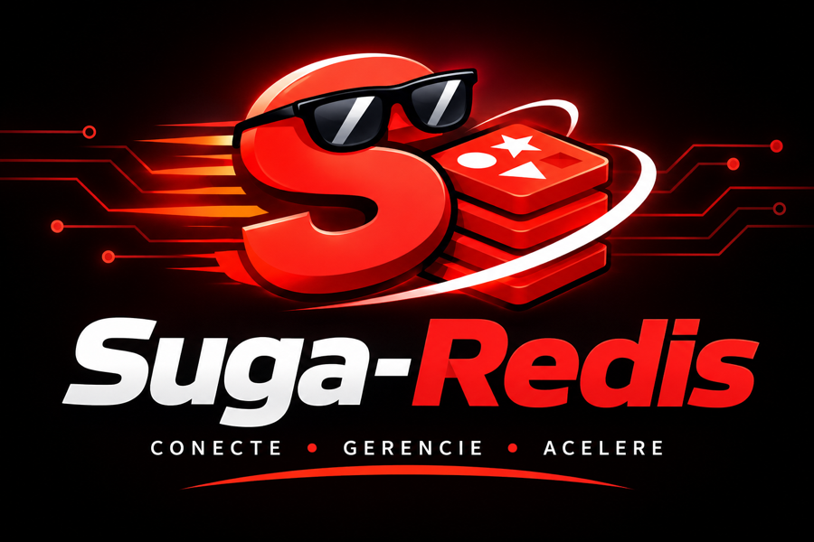
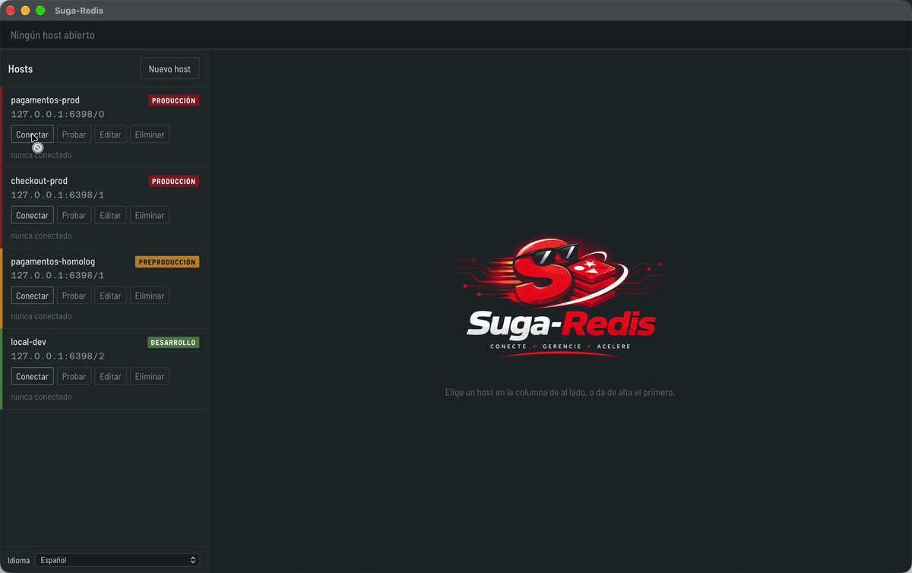
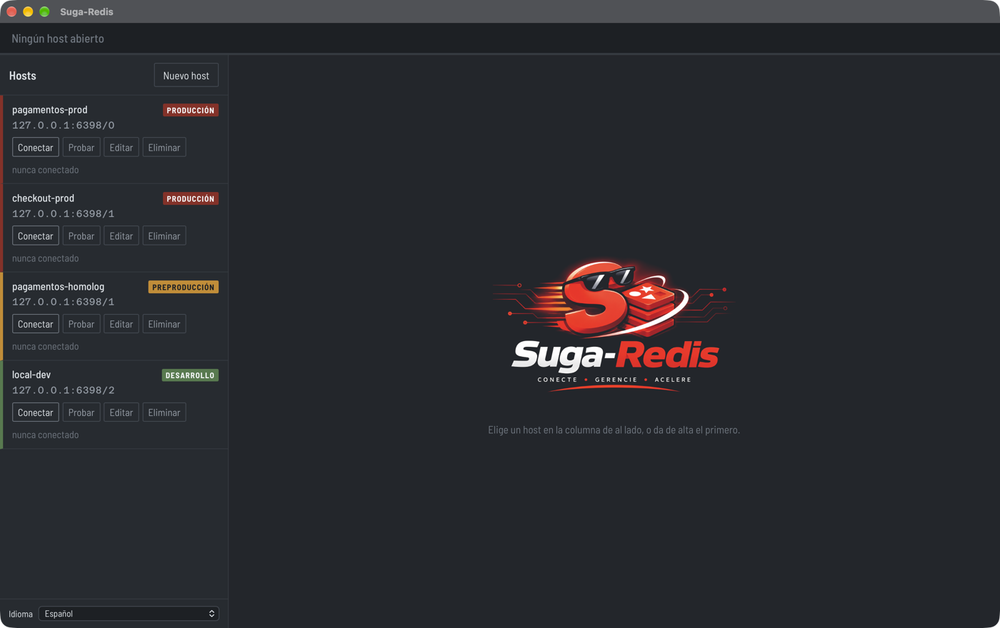
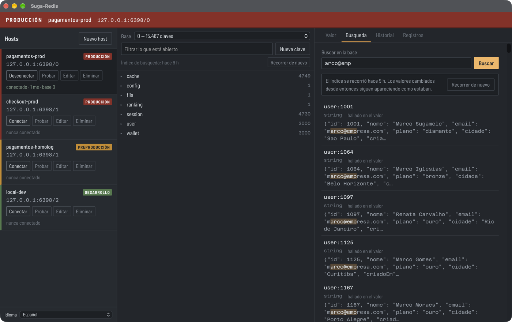
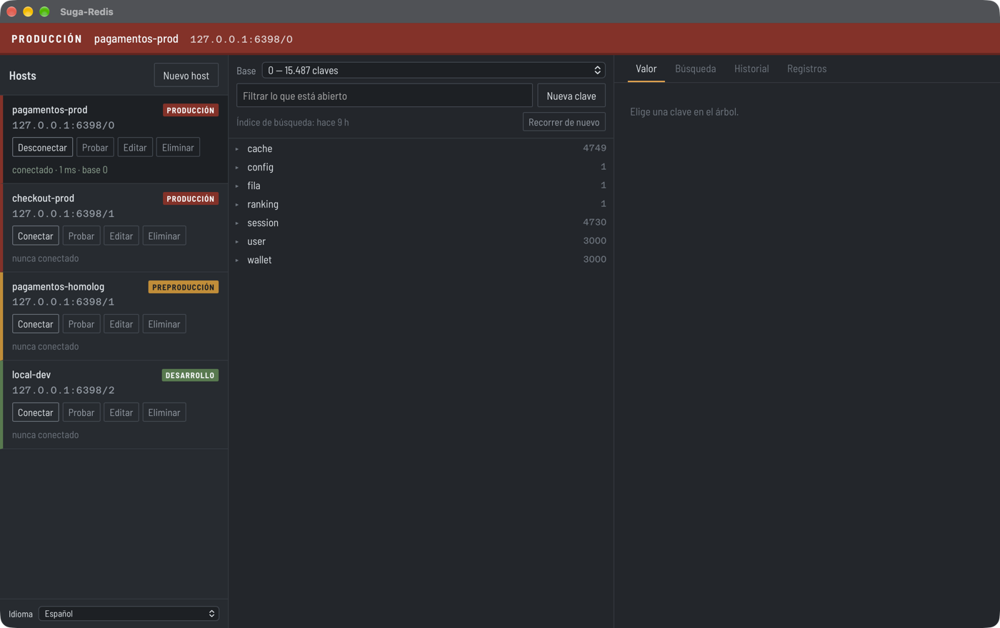
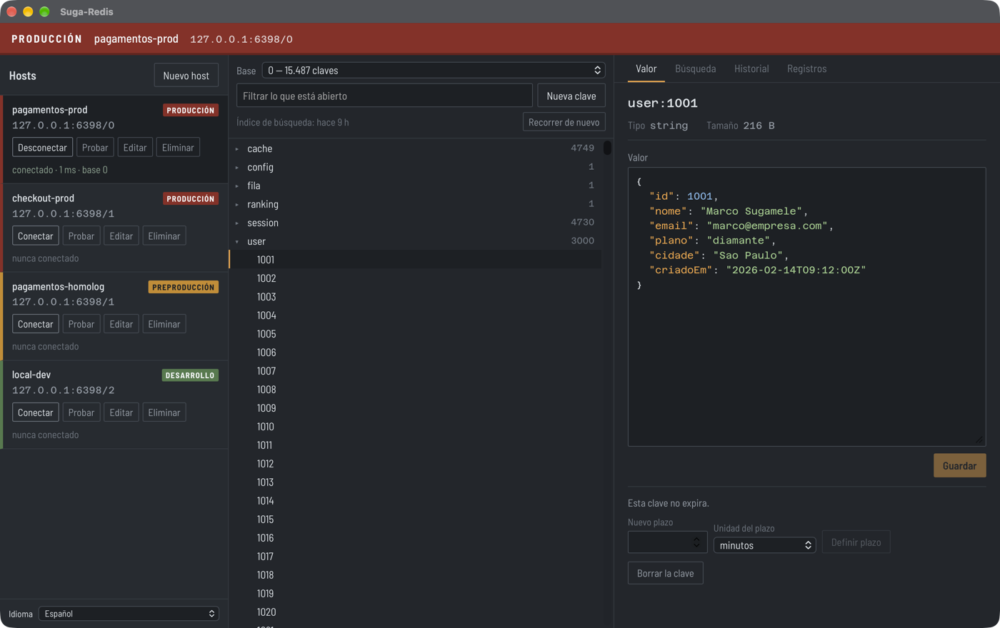
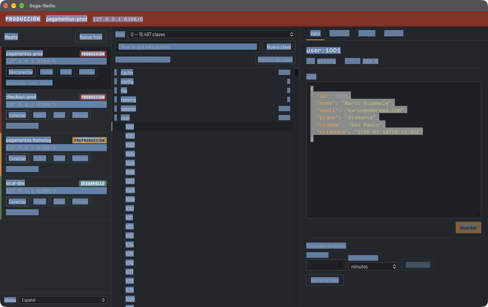
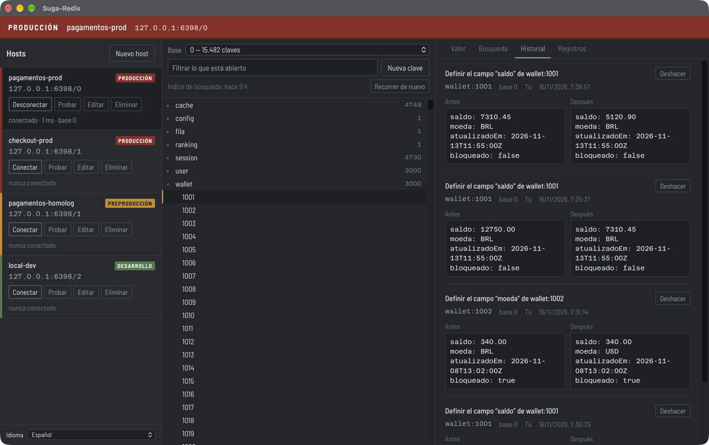
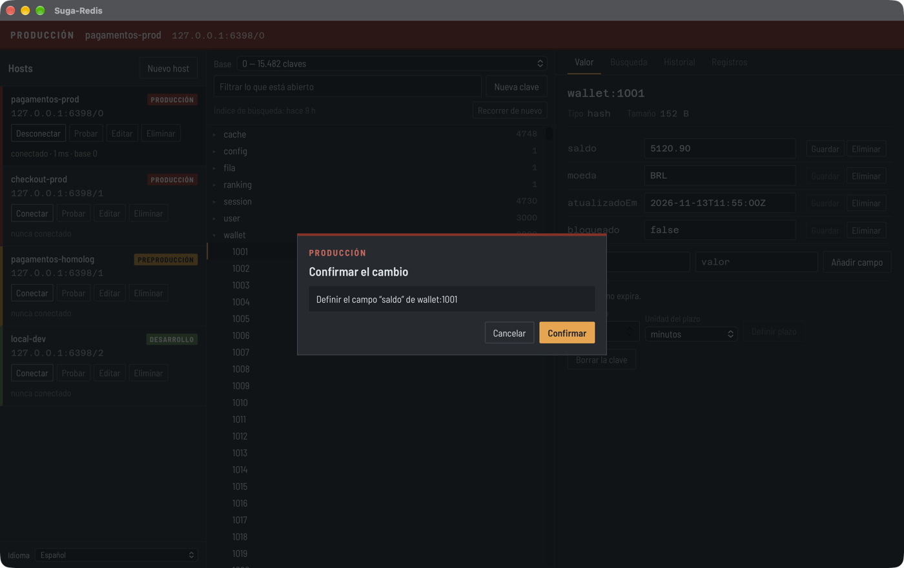
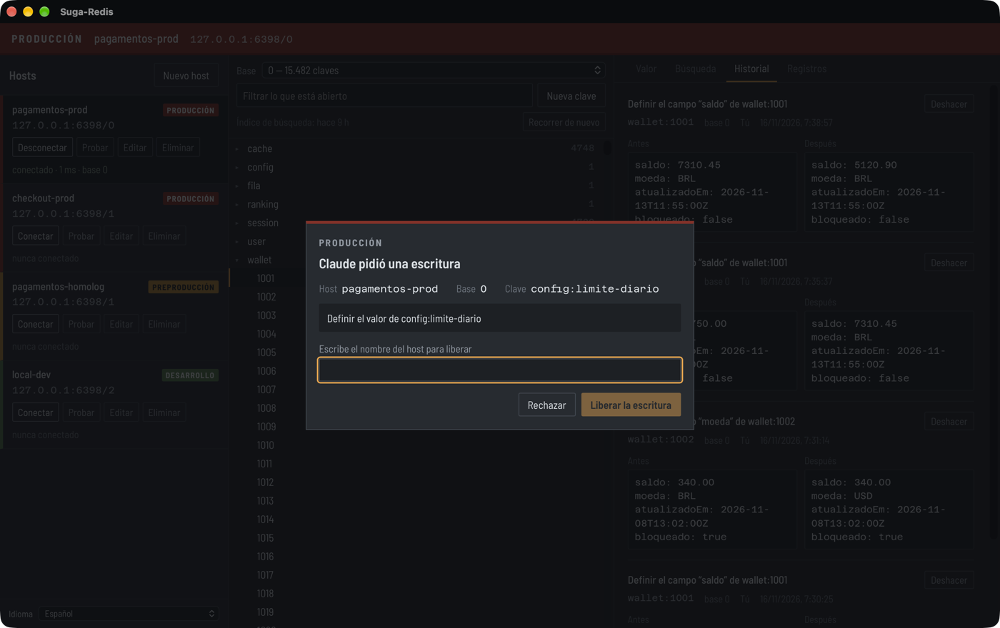

<div align="center">



**Conecta · Gestiona · Acelera**

Un cliente de escritorio para Redis hecho para quien opera bases de datos en
producción — y necesita saber *dónde está pisando* antes de tocar nada.

[](https://github.com/suga/suga-redis/releases/latest)
[](https://github.com/suga/suga-redis/actions/workflows/ci.yml)
[](#macos)
[](#linux)
[](#licencia)

[English](README.md) · [Português (BR)](README.pt-BR.md) · **Español** · [简体中文](README.zh-CN.md) · [Русский](README.ru.md)

### [⬇️  Descargar la última versión](https://github.com/suga/suga-redis/releases/latest)

`.dmg` para macOS · `.AppImage` y `.deb` para Linux · se actualiza solo después

<br>



</div>

## El problema

Abres una herramienta de Redis con cinco pestañas idénticas. Una es
producción. ¿Cuál?

Necesitas al cliente con el correo `ana@empresa.com`, pero está dentro de un
JSON, dentro de una clave, entre cincuenta mil.

Guardas. Era la clave equivocada. ¿Y ahora?

Suga-Redis responde a esas tres preguntas por construcción.

## Qué hace

### 🚦 El entorno grita antes de que te equivoques

La ventana entera cambia de color según el host abierto, con la palabra
estampada arriba: `PRODUCCIÓN`, `PREPRODUCCIÓN`, `DESARROLLO`.

Las MAYÚSCULAS significan **una sola cosa** en toda la aplicación: el
entorno. Ninguna otra etiqueta grita a su lado, así que el sello nunca se
diluye.

En la columna de hosts, cada fila lleva la marca de color de su entorno: se
ve cuántos hosts de producción hay sin leer un solo nombre.



### 🌐 Tres idiomas, y abre en el tuyo

La interfaz habla **español, portugués e inglés**. En la primera apertura
sigue el idioma del sistema; a partir de ahí, el que elijas al pie de la
columna de hosts. Los números y las fechas lo acompañan — `1.234.567` y
`1,234,567` son el mismo número, y el separador equivocado hace que lo
cuentes dos veces.

El sello de entorno se traduce con todo lo demás: una ventana gritando
`PRODUÇÃO` a quien lee en español está gritando justo el aviso que no
entiende.

### 🔎 Búsqueda que entra dentro del valor

Busca `arco@emp` y encuentra `marco@empresa.com` — dentro de un campo de
hash, un elemento de lista, un miembro de sorted set o un JSON guardado como
string.

Subcadena de verdad, en cualquier posición, no solo palabra completa.

**Medido: 3 ms con 5.000 claves indexadas.**

El nombre de las claves se lee del servidor en el momento, así que buscar
por nombre funciona incluso en una base recién abierta, sin barrido alguno.



### 🌳 Un árbol que aguanta una base de verdad

Las claves llegan agrupadas por prefijo (`wallet:`, `cache:`, `session:`),
con el recuento de cada rama. La lista dibuja solo lo que cabe en pantalla:
decenas de miles de claves no congelan la ventana.

Y la lectura es deliberadamente escueta: **once idas y vueltas** para leer
50.000 claves, no trescientas cincuenta. En un Redis gestionado en otra
región, esa es la diferencia entre 1,5 segundos y 45.



### ✏️ Un editor por tipo, con JSON coloreado y validado

Cada tipo tiene su pantalla: `string` con área de texto, `hash` con tabla
campo/valor, `list` con índice, `zset` con miembro y puntuación.

Un valor JSON se abre **coloreado e indentado**, listo para revisar.



Al editar, un validador señala la **línea y la columna** del error — y no te
impide guardar: una string en Redis no tiene por qué ser JSON, y esa
decisión es tuya.



Un valor binario rechaza la edición por texto: lo que volviera del campo ya
no serían los mismos bytes.

### ⏱️ La expiración en tu mano

Mira cuánto falta en cuenta regresiva, define un plazo nuevo en segundos,
minutos, horas o días, o quita la expiración del todo.

### ↩️ Deshacer de verdad

Cada escritura guarda el valor anterior **antes** de que ocurra. El
historial muestra qué cambió, quién lo cambió y cuándo, con el antes y el
después lado a lado — y un botón para deshacer.



### 🔒 Producción pide confirmación

Guardar o borrar en un host de producción abre un diálogo con el resumen
exacto del cambio. Un clic. Nunca escribir una frase.

El cerrojo vive en el backend, no en la pantalla: un botón puede olvidarse
de preguntar, esta función no se puede esquivar.



### 🤖 Claude lee tus bases — y pide permiso para escribir

El mismo binario es un servidor MCP. Conectado a Claude Code, responde cosas
como *"¿cuántas claves de sesión hay y cuándo expiran?"* directamente desde
tu Redis.

Leer funciona con la aplicación cerrada. **Escribir no.** Cuando Claude pide
una escritura, la ventana pasa al frente y tú la liberas escribiendo el
nombre del host. Sin aplicación abierta no hay socket, y la escritura no
ocurre.



Vale en **cualquier entorno**, desarrollo incluido: la confirmación de
producción pregunta *dónde* cae el cambio; este cerrojo pregunta *quién* lo
pidió.

---

## Instalar

> **[⬇️  Descarga aquí](https://github.com/suga/suga-redis/releases/latest)** — después vuelve al paso de tu plataforma.

### macOS

```bash
# 1. abre el .dmg y arrastra la app a Aplicaciones
# 2. ejecuta esto una sola vez:
xattr -dr com.apple.quarantine /Applications/Suga-Redis.app
```

Listo. Abre con normalidad de ahí en adelante — actualizaciones incluidas.

<details>
<summary><b>¿Por qué necesito ese comando?</b> (o: Apple quiere 99 dólares al año para confiar en mí)</summary>

<br>

Para que macOS abra una aplicación sin protestar, el desarrollador necesita
un **Developer ID** — una firma de Apple que cuesta **99 dólares al año**.
Ese dinero, por ahora, sigue siendo café.

Sin pagar, el sistema no tiene forma de saber de dónde vino el programa. No
está diciendo que la aplicación sea peligrosa; está diciendo, con toda
sinceridad, *"no tengo ni idea de quién hizo esto"*. Es justo.

El comando de arriba le quita a la aplicación la marca de cuarentena que el
navegador (o Slack) estampa en todo lo que viene de internet. En la práctica
le estás diciendo a Gatekeeper: **sé de dónde viene, déjalo pasar**. Vale la
precaución de siempre: haz esto solo con un archivo cuyo origen conozcas.
Este lo conoces: el código entero está en esta página, y el `.dmg` salió de
una compilación pública que puedes [leer línea por
línea](.github/workflows/release.yml).

**¿Prefieres no usar la terminal?** El camino oficial llega al mismo sitio:
abre la aplicación, deja que aparezca el aviso y ve a **Ajustes del Sistema
→ Privacidad y seguridad**. Abajo del todo aparece Suga-Redis con un botón
**Abrir igualmente**. (Esa línea solo aparece *después* de intentar abrir la
aplicación, y desaparece en una hora más o menos. Si no la encuentras,
intenta abrir de nuevo y vuelve corriendo.)

La aplicación **sí** está firmada — en modo *ad-hoc*, que garantiza que el
paquete llegó entero y no fue alterado por el camino. Lo que falta es la
parte de pago: la que dice el *nombre* de quien firmó.

</details>

### Linux

**AppImage** — recomendado, es el formato que se actualiza solo:

```bash
chmod +x Suga-Redis_*.AppImage
./Suga-Redis_*.AppImage
```

**`.deb`** — para Debian, Ubuntu y derivadas:

```bash
sudo dpkg -i suga-redis_*.deb
```

Aquí no hay susto de permisos: Linux simplemente confía en que tú decidas
qué corre en tu máquina. x86_64 por ahora.

> El `.deb` avisa cuando sale una versión nueva, pero el cambio es a mano.
> El AppImage lo hace solo.

### Actualizar

Después de la primera instalación no tienes que seguir ningún lanzamiento.

Al abrirse, la aplicación le pregunta a GitHub si hay una versión más nueva.
Si la hay, aparece un aviso discreto en una esquina de la pantalla, con lo
que cambió:

- **Actualizar** — descarga, instala y reabre la aplicación sola
- **Ahora no** — desaparece hasta la próxima vez que la abras

Nada se instala sin que tú lo mandes. Y el paquete descargado se comprueba
contra la clave de firma del proyecto antes de reemplazar nada: lo que no
cuadra se rechaza. Si la red se cae a mitad de camino, la versión que ya
tienes sigue entera.

### Compilarlo tú mismo

Mira [`redis-desk/docs/build.md`](redis-desk/docs/build.md). Son tres comandos.

---

## Empezar a usarlo

1. Abre la aplicación y pulsa **Nuevo host**.
2. Rellena nombre, dirección y puerto. **Elige el entorno con cuidado** — es
   lo que decide el color de la ventana y si la escritura pedirá
   confirmación.
3. Pulsa **Conectar**.

La contraseña va al llavero del sistema, nunca a un archivo.

Para buscar dentro de los valores, pulsa **Recorrer de nuevo** una vez: eso es lo que construye el índice de búsqueda local. Buscar
por nombre de clave ya funciona sin eso.

### Conectarlo a Claude Code

```bash
claude mcp add suga-redis -- /Applications/Suga-Redis.app/Contents/MacOS/suga-redis --mcp
```

Detalles y resolución de problemas en [`redis-desk/docs/mcp-setup.md`](redis-desk/docs/mcp-setup.md).

---

## Dónde viven los datos

| Qué | Dónde |
| :- | :- |
| Registro de hosts | `<datos>/hosts.json` |
| Historial e índice de búsqueda | `<datos>/suga-redis.sqlite` |
| Socket de aprobación | `<datos>/suga-redis.sock` (permiso 0600) |
| **Contraseñas** | **Llavero del sistema, nunca en un archivo** |

`<datos>` es `~/Library/Application Support/com.sugamele.sugaredis` en macOS
y `~/.local/share/com.sugamele.sugaredis` en Linux. La variable
`SUGA_REDIS_DATA_DIR` lo mueve todo, si quieres una segunda instalación en
paralelo.

El índice de búsqueda guarda los valores **en claro**, sin cifrar: es una
copia local de lo que ya está en Redis, y cifrarla solo movería el problema
de sitio. Quien tenga acceso a tu cuenta de usuario tiene acceso a él.

---

## Lo que no hace, a propósito

- **Nunca ejecuta `KEYS`, `FLUSHALL` ni `FLUSHDB`.** El barrido va solo con
  `SCAN` y familia, que no bloquea el servidor.
- **No edita `set`, `stream` ni RedisJSON.** Se abren en modo lectura:
  editarlos exigiría operaciones que este producto no sabe hacer de forma
  atómica.
- **No reordena elementos de lista.** No existe intercambio atómico de
  posiciones, y hacerlo en dos escrituras dejaría la lista mal si la segunda
  fallara. Ausente es mejor que corrompido en silencio.
- **No enmascara ningún valor.** Ni en la pantalla, ni para Claude. Decisión
  registrada del dueño.

---

## Línea de comandos

```
suga-redis              abre la ventana
suga-redis --mcp        corre como servidor MCP en stdio
suga-redis --version    muestra la versión
suga-redis --help       muestra la ayuda
```

## Contribuir

¿Encontraste un fallo, o hizo algo que no esperabas? [Abre una
issue](https://github.com/suga/suga-redis/issues) — sobre todo si hubo una
base de producción de por medio. Ese es el caso que más importa aquí.

Si vas a tocar el código:

```bash
git clone https://github.com/suga/suga-redis.git
cd suga-redis/redis-desk
npm install
npm run tauri dev
```

[`redis-desk/docs/CONTEXTO.md`](redis-desk/docs/CONTEXTO.md) es la lectura
que ahorra tiempo: estado actual, arquitectura, invariantes y las trampas
que ya rompieron este proyecto. Está escrito en portugués, como el resto de
los comentarios del código.
[`redis-desk/docs/build.md`](redis-desk/docs/build.md) cubre pruebas,
empaquetado y cómo sale una versión nueva.

Antes de abrir un PR, el CI va a ejecutar esto — así que conviene
ejecutarlo antes:

```bash
npm test && npm run check          # interfaz
cd src-tauri && cargo test         # núcleo (necesita el Redis de prueba: ./scripts/test-redis.sh up)
```

## Licencia

MIT. Úsalo, cópialo, modifícalo, distribúyelo.

Lo único que este proyecto no puede darte es la firma de pago de Apple —
pero el comando ya te lo sabes.

---

<sub>Traducido de [`README.md`](README.md). Si ambos divergen, el inglés es la fuente.</sub>
