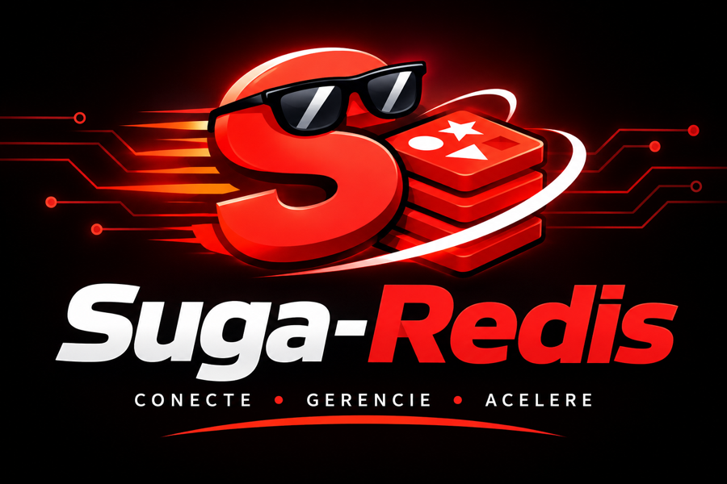
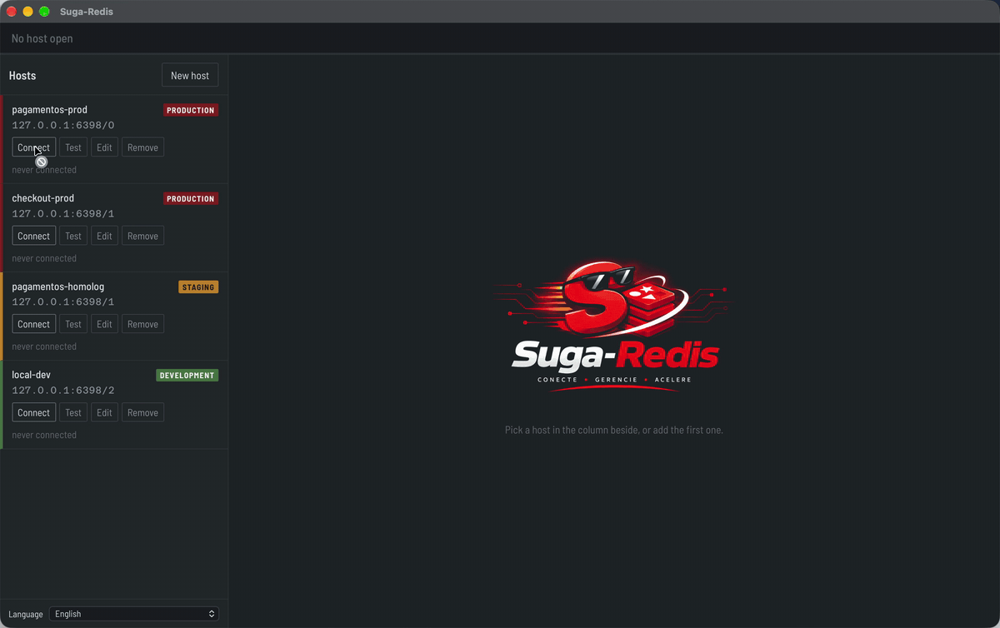
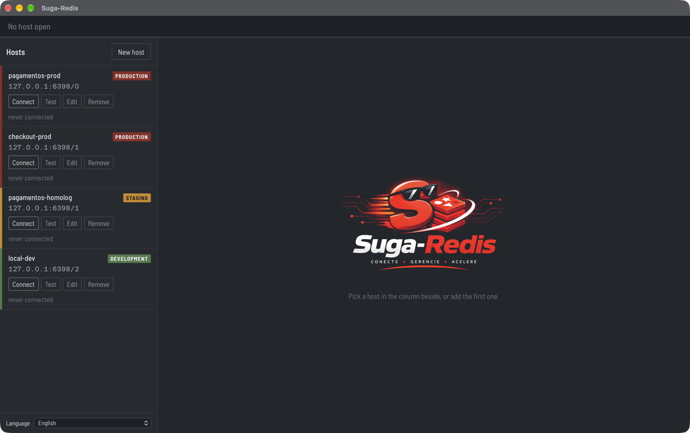
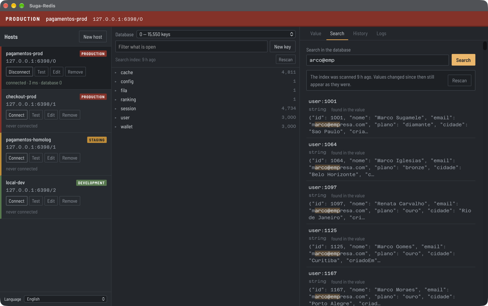
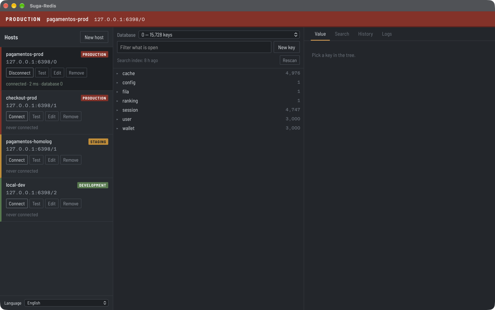
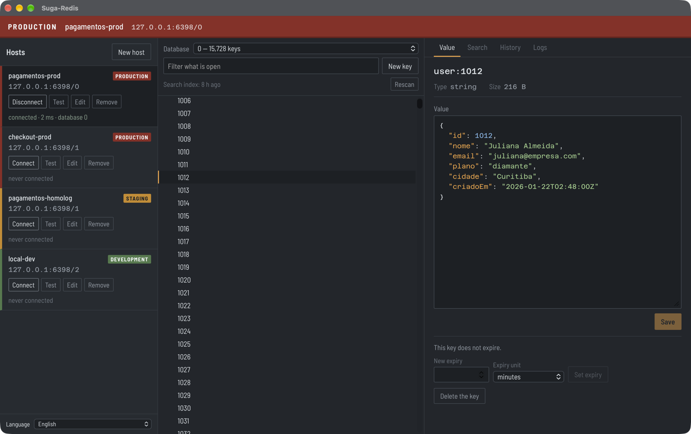
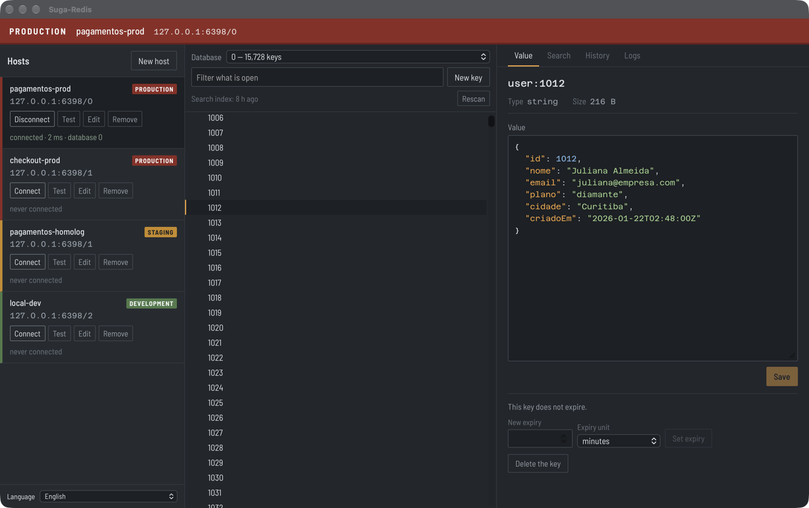
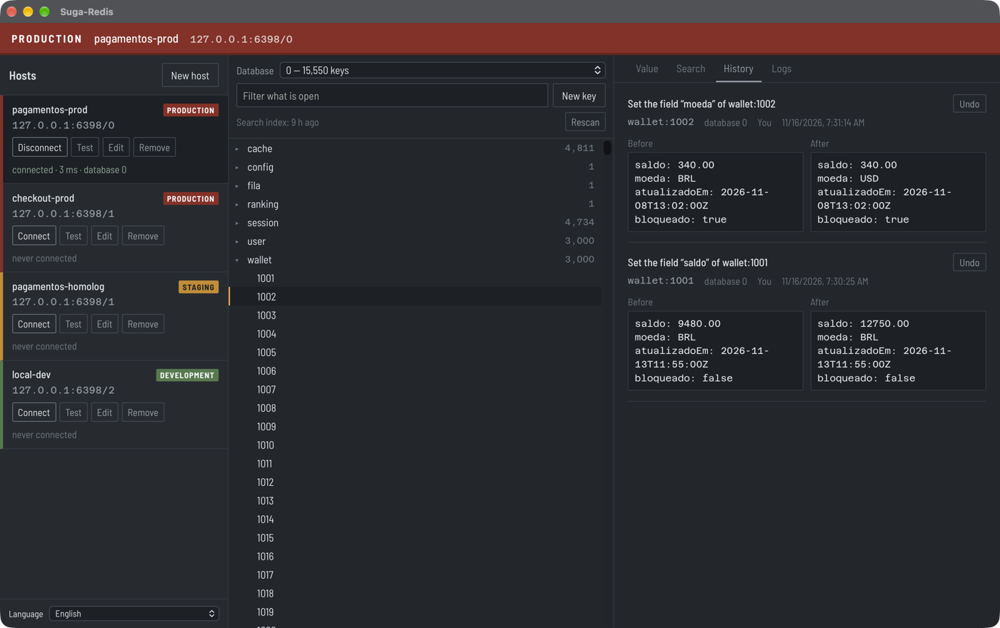
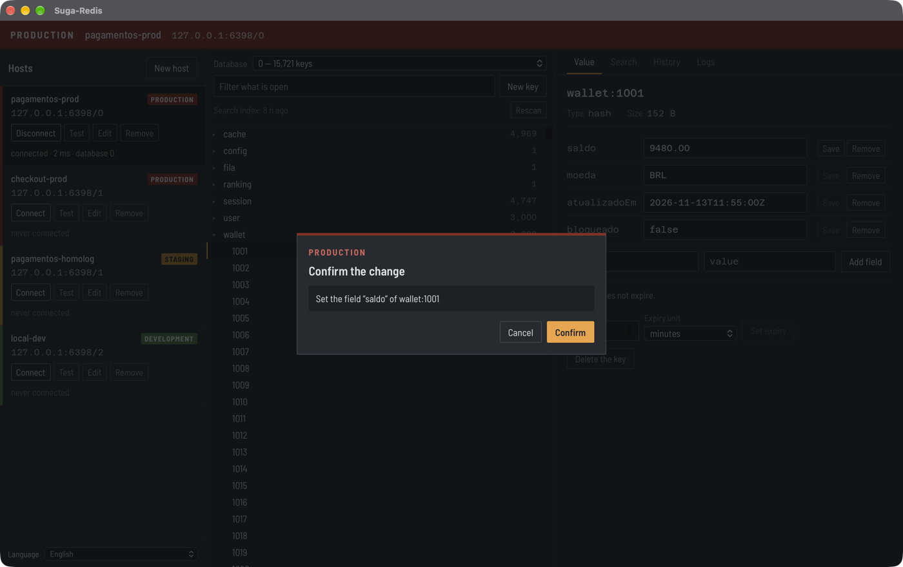
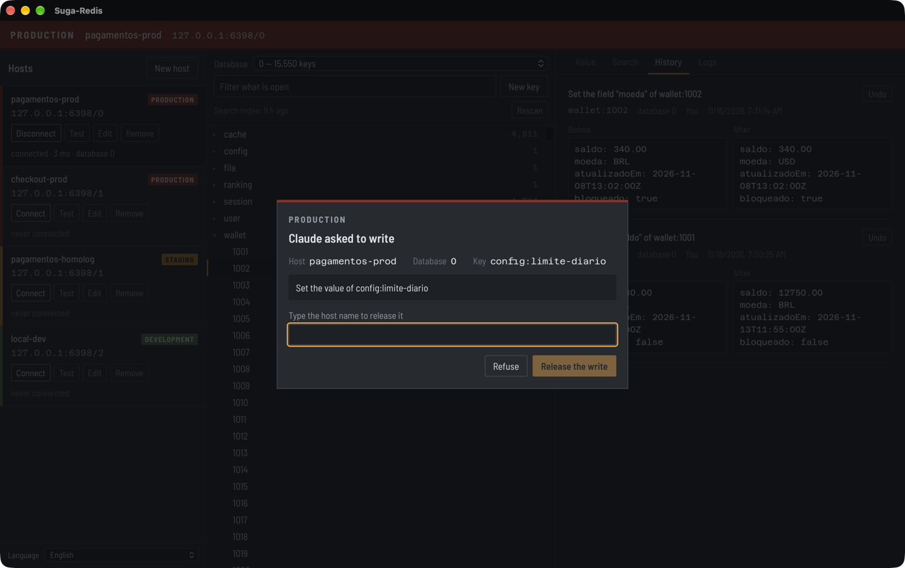

<div align="center">



**Connect · Manage · Accelerate**

A desktop Redis client built for people who work on production databases —
and need to know *where they are standing* before pressing anything.

[](https://github.com/suga/suga-redis/releases/latest)
[](https://github.com/suga/suga-redis/actions/workflows/ci.yml)
[](#macos)
[](#linux)
[](#license)

**English** · [Português (BR)](README.pt-BR.md) · [Español](README.es.md) · [简体中文](README.zh-CN.md) · [Русский](README.ru.md)

### [⬇️  Download the latest version](https://github.com/suga/suga-redis/releases/latest)

`.dmg` for macOS · `.AppImage` and `.deb` for Linux · self-updating afterwards

<br>



</div>

## The problem

You open a Redis tool with five identical tabs. One of them is production.
Which one?

You need the customer whose e-mail is `ana@empresa.com`, but it lives inside
a JSON, inside a key, among fifty thousand of them.

You hit save. It was the wrong key. Now what?

Suga-Redis answers those three questions by construction.

## What it does

### 🚦 The environment shouts before you make a mistake

The whole window changes color according to the open host, with the word
stamped at the top: `PRODUCTION`, `STAGING`, `DEVELOPMENT`.

ALL CAPS means **one thing only** across the entire app — the environment.
No other label shouts alongside it, so the stamp never gets diluted.

In the host column, every row carries the colored mark of its environment:
you can see how many production hosts exist without reading a single name.



### 🌐 Three languages, and it opens in yours

The interface speaks **English, Portuguese and Spanish**. On the first run
it follows the language of your system; from then on, whatever you pick at
the foot of the host column. Numbers and dates follow it too — `1,234,567`
and `1.234.567` are the same number, and the wrong separator makes you count
the digits twice.

The environment stamp is translated with everything else: a window shouting
`PRODUÇÃO` at someone reading English is shouting the one warning they
cannot read.

### 🔎 Search that goes inside the value

Search for `arco@emp` and it finds `marco@empresa.com` — inside a hash
field, a list item, a sorted set member or JSON stored as a string.

A real substring, at any position, not just whole words.

**Measured: 3 ms with 5,000 indexed keys.**

Key names are read from the server on the spot, so searching by name works
even on a database you just opened, with no scan at all.



### 🌳 A tree that survives a real database

Keys arrive grouped by prefix (`wallet:`, `cache:`, `session:`), with the
count for each branch. The list only draws what fits on screen — tens of
thousands of keys do not freeze the window.

And the reading is deliberately lean: **eleven round trips** to read 50,000
keys, not three hundred and fifty. On a managed Redis in another region,
that is the difference between 1.5 seconds and 45.



### ✏️ An editor per type, with colored and validated JSON

Each type gets its own screen: `string` with a text area, `hash` with a
field/value table, `list` with indexes, `zset` with member and score.

A JSON value opens **colored and indented**, ready to be read.



While you edit, a validator points at the **line and column** of the error —
and does not stop you from saving: a Redis string does not have to be JSON,
and that call is yours.



A binary value refuses text editing: what came back from the field would no
longer be the same bytes.

### ⏱️ Expiry in your hands

See the remaining time counting down, set a new deadline in seconds,
minutes, hours or days, or remove the expiry altogether.

### ↩️ Undo that actually undoes

Every write stores the previous value **before** it happens. The history
shows what changed, who changed it and when, with before and after side by
side — and a button to undo.



### 🔒 Production asks for confirmation

Saving or deleting on a production host opens a dialog with the exact
summary of the change. One click. Never type a phrase.

The lock lives in the backend, not in the screen: a button may forget to
ask, this function cannot be bypassed.



### 🤖 Claude reads your databases — and asks permission to write

The same binary is an MCP server. Wired to Claude Code, it answers things
like *"how many session keys are there and when do they expire?"* straight
from your Redis.

Reading works with the app closed. **Writing does not.** When Claude asks
for a write, the window comes to the front and you release it by typing the
host name. With no app open there is no socket, and the write does not
happen.



This holds in **every environment**, development included: the production
confirmation asks *where* the change lands; this lock asks *who* asked for
it.

---

## Install

> **[⬇️  Download here](https://github.com/suga/suga-redis/releases/latest)** — then come back to the step for your platform.

### macOS

```bash
# 1. open the .dmg and drag the app into Applications
# 2. run this exactly once:
xattr -dr com.apple.quarantine /Applications/Suga-Redis.app
```

Done. It opens normally from then on — updates included.

<details>
<summary><b>Why do I need that command?</b> (or: Apple wants US$ 99 a year to trust me)</summary>

<br>

For macOS to open an app without complaining, the developer needs a
**Developer ID** — an Apple signature that costs **US$ 99 a year**. That
money, for now, is still coffee.

Without paying, the system has no way of knowing where the program came
from. It is not saying the app is dangerous; it is saying, quite honestly,
*"I have no idea who made this"*. Fair enough.

The command above strips the quarantine mark that your browser (or Slack)
stamps on everything that comes from the internet. In practice you are
telling Gatekeeper: **I know where this came from, let it through**. The
usual caveat applies — only do this with a file whose source you know. This
one you know: the entire code is on this page, and the `.dmg` came out of a
public build you can [read line by line](.github/workflows/release.yml).

**Rather not use the terminal?** The official path gets you the same place:
open the app, let the warning appear, then go to **System Settings →
Privacy & Security**. Near the bottom you will find Suga-Redis with an
**Open Anyway** button. (That row only appears *after* you try to open the
app, and it disappears in about an hour. If you cannot find it, try opening
again and go back quickly.)

The app **is** signed — in *ad-hoc* mode, which guarantees the bundle
arrived whole and was not tampered with on the way. What is missing is the
paid part: the one that states the *name* of who signed it.

</details>

### Linux

**AppImage** — recommended, it is the format that updates itself:

```bash
chmod +x Suga-Redis_*.AppImage
./Suga-Redis_*.AppImage
```

**`.deb`** — for Debian, Ubuntu and derivatives:

```bash
sudo dpkg -i suga-redis_*.deb
```

No permission scare here: Linux simply trusts you to decide what runs on
your machine. x86_64 for now.

> The `.deb` tells you when a new version is out, but the swap is manual.
> The AppImage does it by itself.

### Updating

After the first install you do not have to follow any release.

On launch, the app asks GitHub whether a newer version exists. If it does, a
discreet notice appears in a corner of the screen, with what changed:

- **Update** — downloads, installs and reopens the app by itself
- **Not now** — gone until the next time you open it

Nothing is installed without you saying so. And the downloaded package is
checked against the project's signing key before anything is replaced: what
does not match is refused. If the network drops midway, the version you
already have stays intact.

### Build it yourself

See [`redis-desk/docs/build.md`](redis-desk/docs/build.md). Three commands.

---

## Getting started

1. Open the app and click **New host**.
2. Fill in name, address and port. **Choose the environment carefully** — it
   decides the window color and whether writing will ask for confirmation.
3. Click **Connect**.

The password goes to the system keychain, never to a file.

To search inside values, click **Rescan** once: that is
what builds the local search index. Searching by key name already works
without it.

### Wiring it to Claude Code

```bash
claude mcp add suga-redis -- /Applications/Suga-Redis.app/Contents/MacOS/suga-redis --mcp
```

Details and troubleshooting in [`redis-desk/docs/mcp-setup.md`](redis-desk/docs/mcp-setup.md).

---

## Where the data lives

| What | Where |
| :- | :- |
| Host registry | `<data>/hosts.json` |
| History and search index | `<data>/suga-redis.sqlite` |
| Approval socket | `<data>/suga-redis.sock` (mode 0600) |
| **Passwords** | **System keychain, never in a file** |

`<data>` is `~/Library/Application Support/com.sugamele.sugaredis` on macOS
and `~/.local/share/com.sugamele.sugaredis` on Linux. The
`SUGA_REDIS_DATA_DIR` variable moves all of it, if you want a second
installation side by side.

The search index stores values **in the clear**, unencrypted: it is a local
copy of what is already in Redis, and encrypting it would only move the
problem elsewhere. Whoever has access to your user account has access to it.

---

## What it does not do, on purpose

- **It never runs `KEYS`, `FLUSHALL` or `FLUSHDB`.** Scanning happens only
  through `SCAN` and family, which does not block the server.
- **It does not edit `set`, `stream` or RedisJSON.** They open read-only:
  editing them would require operations this product cannot perform
  atomically.
- **It does not reorder list items.** There is no atomic swap of positions,
  and doing it in two writes would leave the list wrong if the second one
  failed. Absent beats silently corrupted.
- **It masks no value.** Not on screen, not for Claude. A recorded decision
  by the owner.

---

## Command line

```
suga-redis              opens the window
suga-redis --mcp        runs as an MCP server over stdio
suga-redis --version    prints the version
suga-redis --help       prints the help
```

## Contributing

Found a bug, or did it do something you did not expect? [Open an
issue](https://github.com/suga/suga-redis/issues) — especially if a
production database was involved. That is the case that matters most here.

If you are going to touch the code:

```bash
git clone https://github.com/suga/suga-redis.git
cd suga-redis/redis-desk
npm install
npm run tauri dev
```

[`redis-desk/docs/CONTEXTO.md`](redis-desk/docs/CONTEXTO.md) is the reading
that saves time: current state, architecture, invariants and the traps that
have already broken this project. It is written in Portuguese, like the rest
of the code comments. [`redis-desk/docs/build.md`](redis-desk/docs/build.md)
covers tests, packaging and how a new version ships.

Before opening a PR, CI will run this — so it is worth running first:

```bash
npm test && npm run check          # interface
cd src-tauri && cargo test         # core (needs the test Redis: ./scripts/test-redis.sh up)
```

## License

MIT. Use it, copy it, modify it, distribute it.

The only thing this project cannot give you is Apple's paid signature — but
you already know the command.
