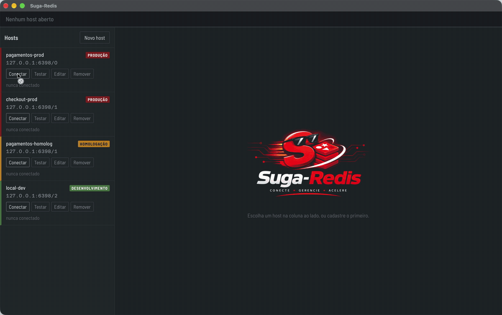
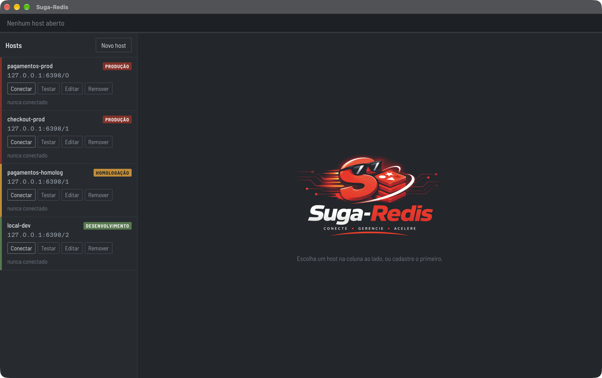
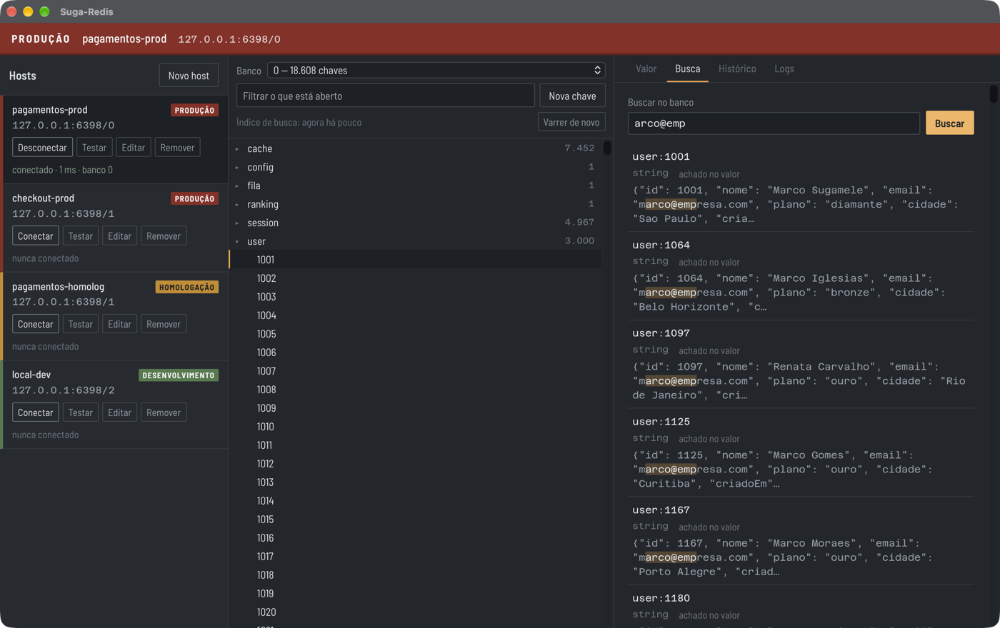
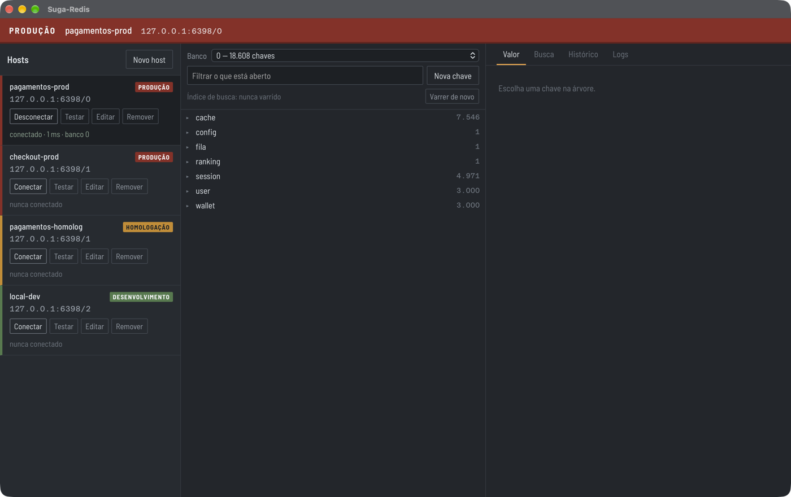
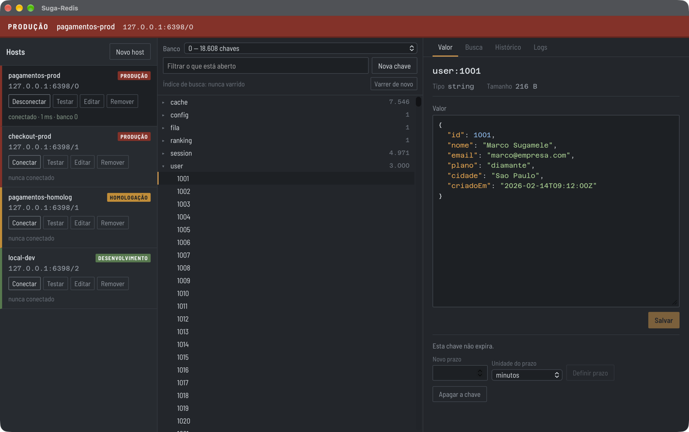
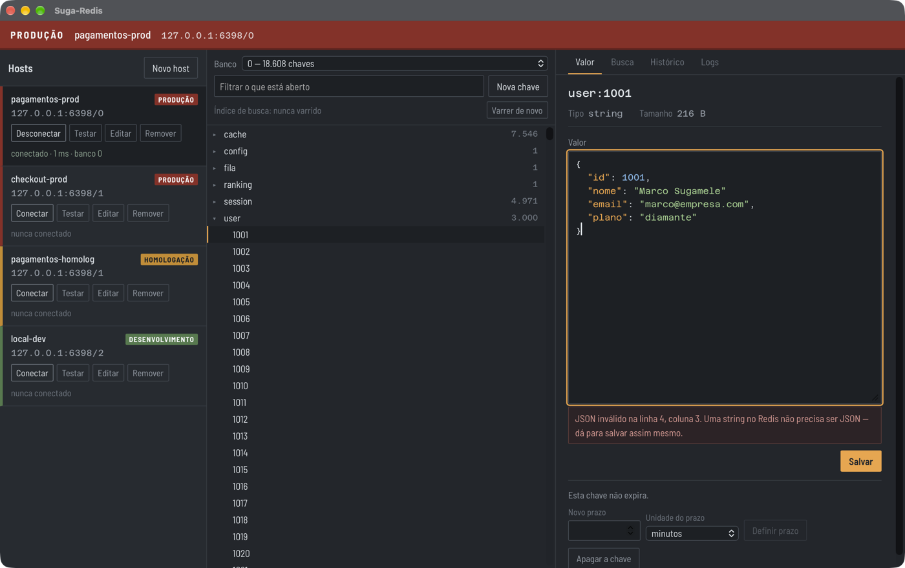
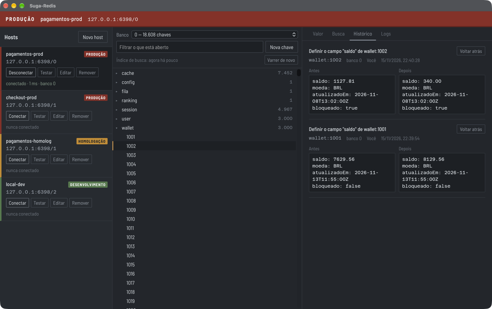
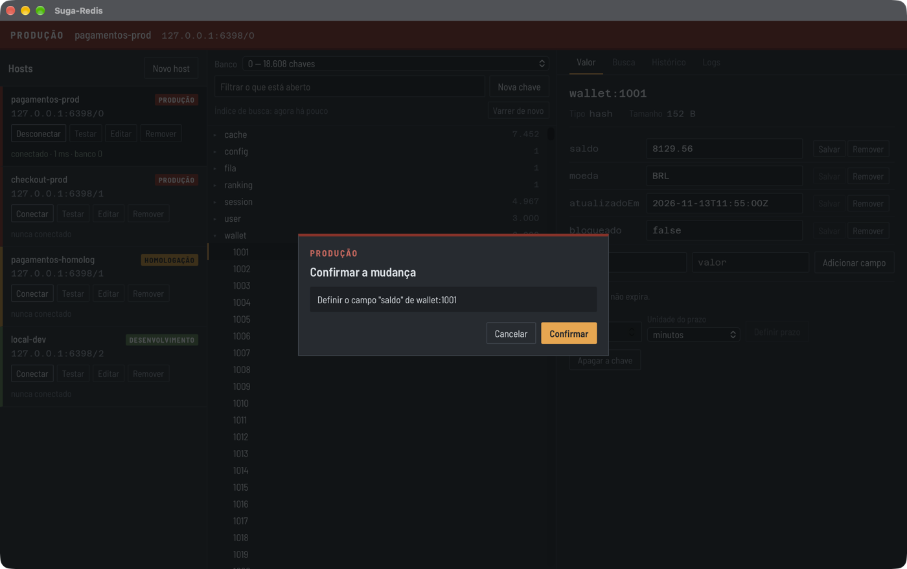
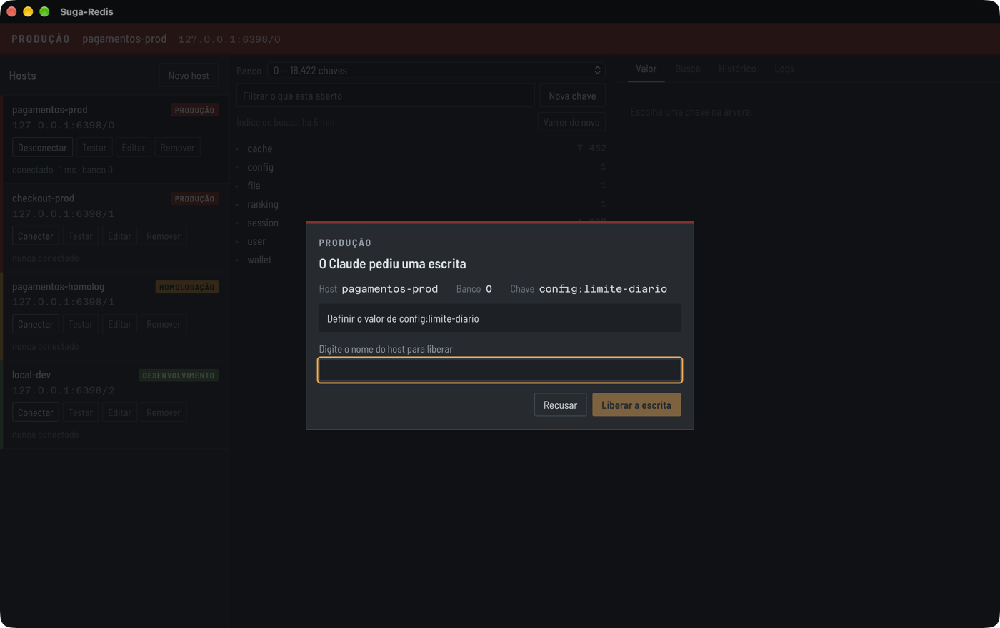

<div align="center">


**Conecte · Gerencie · Acelere**

Um cliente de mesa para Redis feito para quem opera banco de produção —
e precisa saber *onde está pisando* antes de apertar qualquer coisa.

[](https://github.com/suga/suga-redis/releases/latest)
[](https://github.com/suga/suga-redis/actions/workflows/ci.yml)
[](#macos)
[](#linux)
[](#licença)

### [⬇️  Baixar a última versão](https://github.com/suga/suga-redis/releases/latest)

`.dmg` para macOS · `.AppImage` e `.deb` para Linux · atualiza sozinho depois

<br>



</div>

---

## O problema

Você abre uma ferramenta de Redis com cinco abas iguais. Uma é produção. Qual?

Você precisa achar o cliente com o e-mail `ana@empresa.com`, mas ele está
dentro de um JSON, dentro de uma chave, entre cinquenta mil.

Você salva. Era a chave errada. E agora?

O Suga-Redis responde essas três perguntas por construção.

## O que ele faz

### 🚦 O ambiente grita antes de você errar

A janela inteira muda de cor conforme o host aberto, com a palavra carimbada
no topo: `PRODUÇÃO`, `HOMOLOGAÇÃO`, `DESENVOLVIMENTO`.

Caixa alta tem **um significado só** no app inteiro — o ambiente. Nenhum
outro rótulo grita junto, então o carimbo nunca se dilui.

Na coluna de hosts, cada linha carrega a marca colorida do seu ambiente: dá
para ver quantos hosts de produção existem sem ler um nome sequer.



### 🔎 Busca que entra dentro do valor

Procure `arco@emp` e ele acha `marco@empresa.com` — dentro de campo de hash,
item de lista, membro de sorted set ou JSON guardado como string.

Substring de verdade, em qualquer posição, não só palavra inteira.

**Medido: 3 ms com 5.000 chaves indexadas.**

O nome das chaves é lido do servidor na hora, então a busca por nome funciona
mesmo num banco recém-aberto, sem varredura nenhuma.



### 🌳 Árvore que aguenta um banco de verdade

As chaves vêm agrupadas por prefixo (`wallet:`, `cache:`, `session:`), com a
contagem de cada galho. A lista desenha só o que cabe na tela — dezenas de
milhares de chaves não travam a janela.

E a leitura é enxuta de propósito: **onze idas e voltas** para ler 50 mil
chaves, não trezentas e cinquenta. Num Redis gerenciado em outra região, isso
é a diferença entre 1,5 segundo e 45.



### ✏️ Editor por tipo, com JSON colorido e validado

Cada tipo tem sua tela: `string` com área de texto, `hash` com tabela
campo/valor, `list` com índice, `zset` com membro e pontuação.

Valor em JSON abre **colorido e indentado**, pronto para conferir.



Ao editar, um validador aponta **linha e coluna** do erro — e não te impede de
salvar: uma string no Redis não precisa ser JSON, e quem decide isso é você.



Valor binário recusa edição por texto: o que voltasse do campo já não seriam
os mesmos bytes.

### ⏱️ Prazo de expiração na mão

Veja quanto falta em contagem regressiva, defina um prazo novo em segundos,
minutos, horas ou dias, ou tire o prazo de vez.

### ↩️ Volta atrás de verdade

Toda escrita guarda o valor anterior **antes** de acontecer. O histórico
mostra o que mudou, quem mudou e quando, com antes e depois lado a lado — e
um botão para desfazer.



### 🔒 Produção pede confirmação

Salvar ou apagar em host de produção abre um diálogo com o resumo exato da
mudança. Um clique. Nunca digitar frase.

A trava mora no backend, não na tela: um botão pode esquecer de perguntar,
essa função não pode ser contornada.



### 🤖 O Claude lê seus bancos — e pede licença para escrever

O mesmo binário é um servidor MCP. Ligado ao Claude Code, ele responde coisas
como *"quantas chaves de sessão existem e quando expiram?"* direto do seu
Redis.

Ler funciona sem o app aberto. **Escrever, não.** Quando o Claude pede uma
escrita, a janela vem para a frente e você libera digitando o nome do host.
Sem app aberto, não existe socket, e a escrita não acontece.



Vale em **qualquer ambiente**, inclusive desenvolvimento: a confirmação de
produção pergunta *onde* a mudança cai; esta trava pergunta *quem* pediu.

---

## Instalar

> **[⬇️  Baixe aqui](https://github.com/suga/suga-redis/releases/latest)** — depois volte para o passo da sua plataforma.

### macOS

```bash
# 1. abra o .dmg e arraste o app para Aplicativos
# 2. rode isto uma única vez:
xattr -dr com.apple.quarantine /Applications/Suga-Redis.app
```

Pronto. Abre normal daí em diante — inclusive nas atualizações.

<details>
<summary><b>Por que preciso desse comando?</b> (ou: a Apple quer US$ 99 por ano para confiar em mim)</summary>

<br>

Para o macOS abrir um app sem reclamar, o desenvolvedor precisa de um
**Developer ID** — uma assinatura da Apple que custa **US$ 99 por ano**.
Esse dinheiro, por ora, segue sendo café.

Sem pagar, o sistema não tem como saber de quem veio o programa. Ele não
está dizendo que o app é perigoso; está dizendo, com toda a sinceridade,
*"não faço ideia de quem fez isso"*. Justo.

O comando acima tira do app a marca de quarentena que o navegador (ou o
Slack) carimba em tudo que vem da internet. Na prática você está dizendo ao
Gatekeeper: **eu sei de onde veio, pode deixar**. Vale o de sempre — só faça
isso com arquivo de fonte que você conhece. Esta aqui, você conhece: o
código inteiro está nesta página, e o `.dmg` saiu de um build público que
você pode [ler linha por linha](.github/workflows/release.yml).

**Prefere não usar o terminal?** Dá no mesmo pelo caminho oficial: abra o
app, deixe o aviso aparecer, e vá em **Ajustes do Sistema → Privacidade e
Segurança**. Lá embaixo aparece o Suga-Redis com um botão **Abrir Mesmo
Assim**. (A linha só aparece *depois* da tentativa de abrir, e some em mais
ou menos uma hora. Se não achar, tente abrir de novo e volte correndo.)

O app **é** assinado — em modo *ad-hoc*, que garante que o pacote chegou
inteiro e não foi adulterado no caminho. O que falta é a parte paga: a que
diz o *nome* de quem assinou.

</details>

### Linux

**AppImage** — recomendado, é o formato que se atualiza sozinho:

```bash
chmod +x Suga-Redis_*.AppImage
./Suga-Redis_*.AppImage
```

**`.deb`** — para Debian, Ubuntu e derivados:

```bash
sudo dpkg -i suga-redis_*.deb
```

Nenhum susto de permissão aqui: o Linux simplesmente confia em você para
decidir o que roda na sua máquina. x86_64 por enquanto.

> O `.deb` avisa quando sai versão nova, mas a troca é na mão. O AppImage
> faz sozinho.

### Atualizar

Depois da primeira instalação, você não precisa acompanhar lançamento
nenhum.

Ao abrir, o app pergunta ao GitHub se existe versão mais nova. Se existir,
aparece um aviso discreto num canto da tela, com o que mudou:

- **Atualizar** — baixa, instala e reabre o app sozinho
- **Agora não** — some até a próxima vez que você abrir

Nada é instalado sem você mandar. E o pacote baixado é conferido contra a
chave de assinatura do projeto antes de substituir qualquer coisa: o que
não confere é recusado. Se a rede cair no meio, a versão que você já tem
continua inteira.

### Compilar você mesmo

Veja [`redis-desk/docs/build.md`](redis-desk/docs/build.md). São três comandos.

---

## Começar a usar

1. Abra o app e clique em **Novo host**.
2. Preencha nome, endereço e porta. **Escolha o ambiente com atenção** — é
   ele que decide a cor da janela e se a escrita vai pedir confirmação.
3. Clique em **Conectar**.

A senha vai para o chaveiro do sistema, nunca para um arquivo.

Para procurar dentro dos valores, clique em **Varrer de novo** uma vez: é o
que monta o índice de busca local. Procurar por nome de chave já funciona
sem isso.

### Ligar ao Claude Code

```bash
claude mcp add suga-redis -- /Applications/Suga-Redis.app/Contents/MacOS/suga-redis --mcp
```

Detalhes e solução de problemas em [`redis-desk/docs/mcp-setup.md`](redis-desk/docs/mcp-setup.md).

---

## Onde ficam os dados

| O quê | Onde |
| :- | :- |
| Cadastro de hosts | `<dados>/hosts.json` |
| Histórico e índice de busca | `<dados>/suga-redis.sqlite` |
| Socket de aprovação | `<dados>/suga-redis.sock` (permissão 0600) |
| **Senhas** | **Chaveiro do sistema, nunca em arquivo** |

`<dados>` é `~/Library/Application Support/com.sugamele.sugaredis` no mac e
`~/.local/share/com.sugamele.sugaredis` no linux. A variável
`SUGA_REDIS_DATA_DIR` reposiciona tudo, se quiser uma segunda instalação lado
a lado.

O índice de busca guarda os valores **em claro**, sem cifrar: é uma cópia
local do que já está no Redis, e cifrá-la só mudaria o problema de lugar.
Quem tem acesso à sua conta de usuário tem acesso a ele.

---

## O que ele não faz, de propósito

- **Nunca roda `KEYS`, `FLUSHALL` ou `FLUSHDB`.** Varredura só com `SCAN` e
  família, que não bloqueia o servidor.
- **Não edita `set`, `stream` nem RedisJSON.** Abrem em modo leitura:
  editá-los exigiria operações que este produto não sabe fazer de forma
  atômica.
- **Não reordena itens de lista.** Não existe troca atômica de posições, e
  fazer em duas escritas deixaria a lista errada se a segunda falhasse.
  Ausente é melhor que silenciosamente corrompido.
- **Não mascara valor nenhum.** Nem na tela, nem para o Claude. Decisão
  registrada do dono.

---

## Linha de comando

```
suga-redis              abre a janela
suga-redis --mcp        roda como servidor MCP em stdio
suga-redis --version    mostra a versão
suga-redis --help       mostra a ajuda
```

## Contribuir

Achou um bug, ou ele fez algo que você não esperava? [Abra uma
issue](https://github.com/suga/suga-redis/issues) — principalmente se
envolveu um banco de produção. Esse é o caso que mais importa aqui.

Se for mexer no código:

```bash
git clone https://github.com/suga/suga-redis.git
cd suga-redis/redis-desk
npm install
npm run tauri dev
```

[`redis-desk/docs/CONTEXTO.md`](redis-desk/docs/CONTEXTO.md) é a leitura que poupa tempo: estado
atual, arquitetura, invariantes e as armadilhas que já quebraram este
projeto. [`redis-desk/docs/build.md`](redis-desk/docs/build.md) cobre testes, empacotamento e como
sai uma versão nova.

Antes de abrir um PR, o CI vai rodar isto — então vale rodar antes:

```bash
npm test && npm run check          # interface
cd src-tauri && cargo test         # núcleo (precisa do Redis de teste: ./scripts/test-redis.sh up)
```

## Licença

MIT. Use, copie, modifique, distribua.

A única coisa que este projeto não pode te dar é a assinatura paga da
Apple — mas você já sabe o comando.
