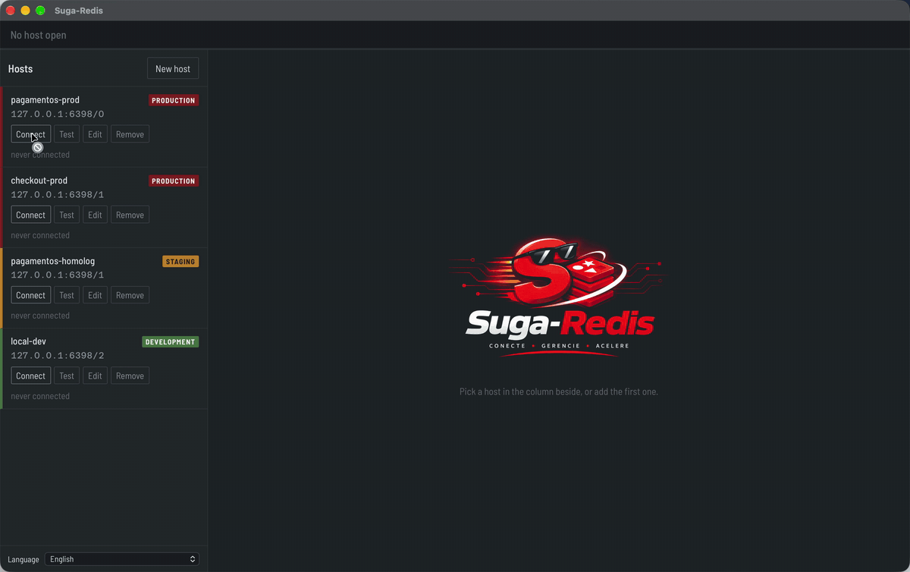
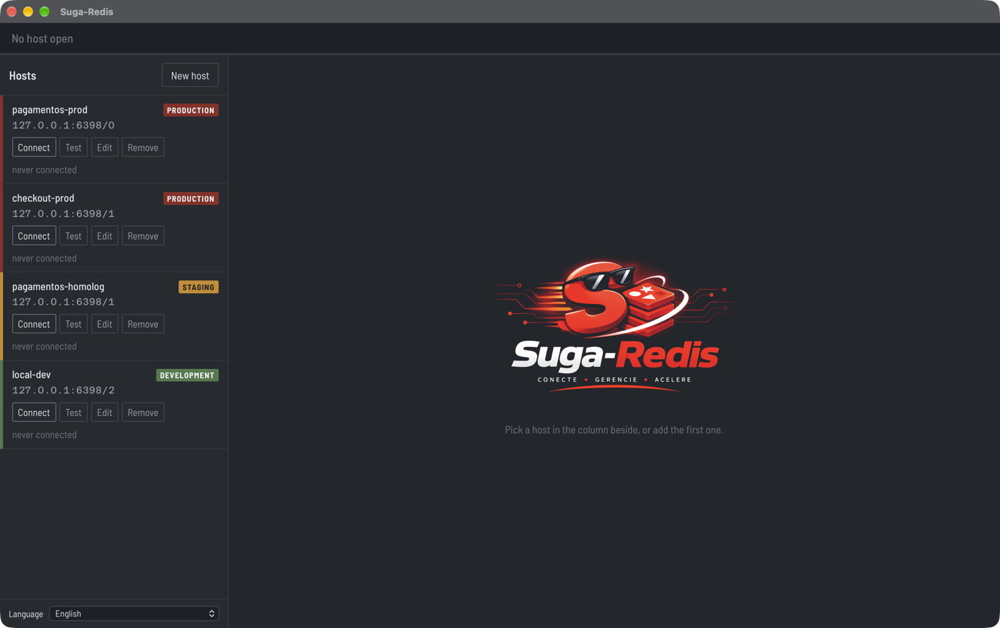
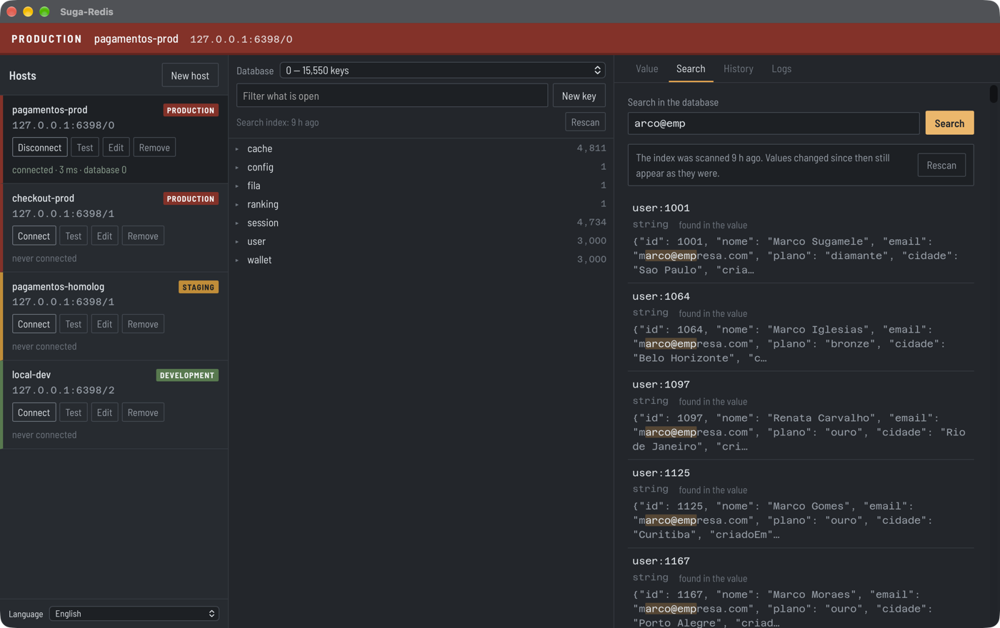
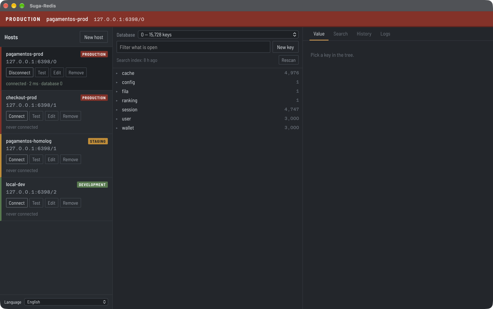
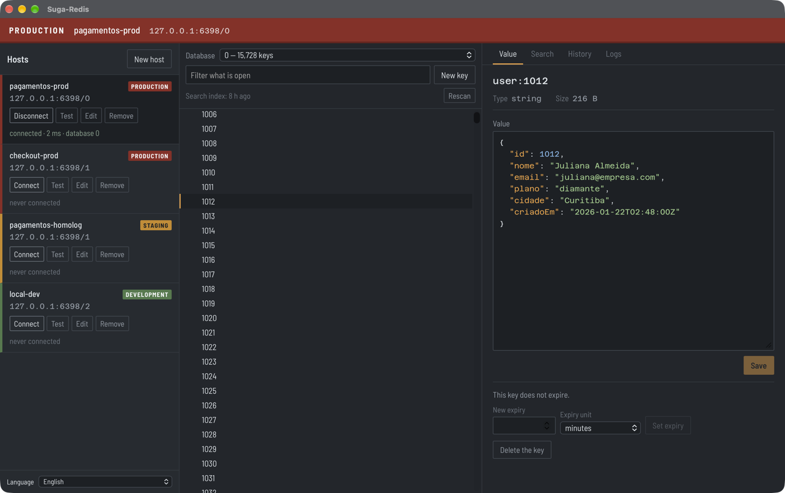
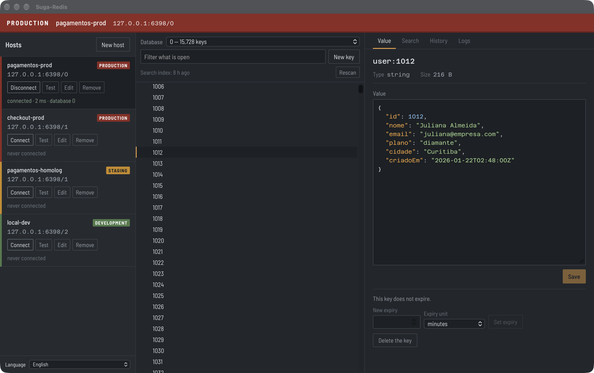
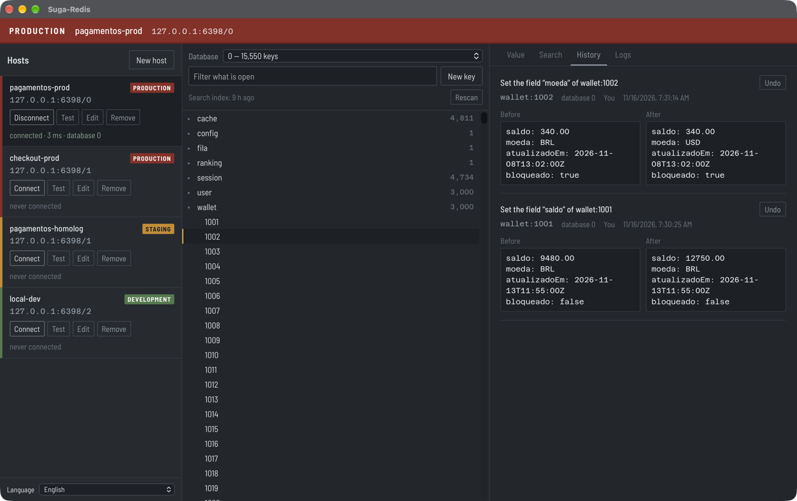
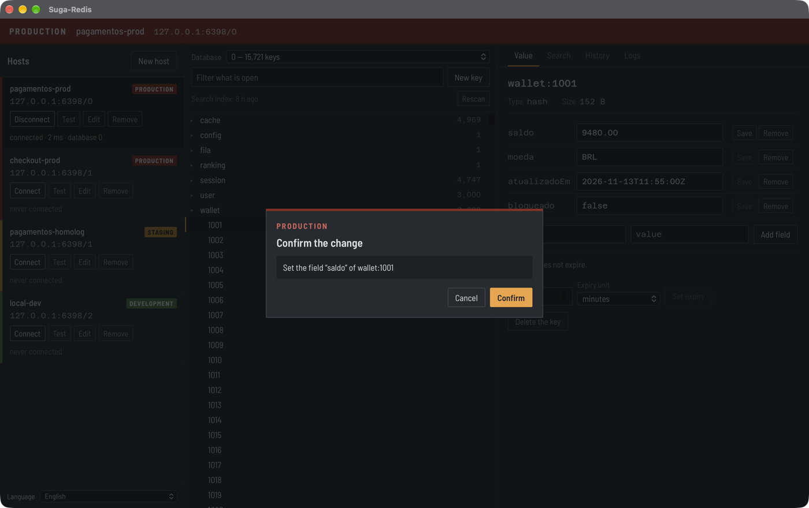
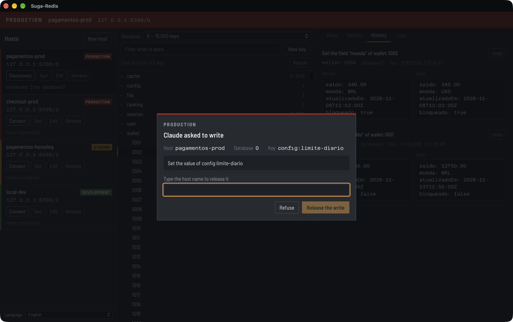

<div align="center">


**Подключайся · Управляй · Ускоряй**

Настольный клиент для Redis, сделанный для тех, кто работает с продакшеном —
и кому нужно знать, *где он стоит*, прежде чем что-то нажать.

[](https://github.com/suga/suga-redis/releases/latest)
[](https://github.com/suga/suga-redis/actions/workflows/ci.yml)
[](#macos)
[](#linux)
[](#лицензия)

[English](README.md) · [Português (BR)](README.pt-BR.md) · [Español](README.es.md) · [简体中文](README.zh-CN.md) · **Русский**

### [⬇️  Скачать последнюю версию](https://github.com/suga/suga-redis/releases/latest)

`.dmg` для macOS · `.AppImage` и `.deb` для Linux · дальше обновляется сам

<br>



</div>

## Задача

Вы открываете инструмент для Redis с пятью одинаковыми вкладками. Одна из них —
продакшен. Какая?

Вам нужен клиент с почтой `ana@empresa.com`, но она лежит внутри JSON,
внутри ключа, среди пятидесяти тысяч таких же.

Вы сохранили. Ключ был не тот. И что теперь?

Suga-Redis отвечает на эти три вопроса самой своей конструкцией.

## Что он умеет

### 🚦 Окружение кричит раньше, чем вы ошибётесь

Всё окно меняет цвет в зависимости от открытого хоста, а сверху стоит слово:
`PRODUCTION`, `STAGING`, `DEVELOPMENT`.

ПРОПИСНЫЕ БУКВЫ во всём приложении значат **ровно одно** — окружение.
Ни одна другая надпись не кричит рядом, поэтому штамп никогда не размывается.

В колонке хостов каждая строка несёт цветную метку своего окружения:
видно, сколько продакшен-хостов в списке, не читая ни одного названия.



### 🌐 Три языка, и открывается на вашем

Интерфейс говорит по-**английски, по-португальски и по-испански** —
русского пока нет, поэтому с русской системой он откроется на английском.
Язык переключается внизу колонки хостов. Числа и даты идут следом: `1 234 567` и `1,234,567` —
одно и то же число, а неверный разделитель заставляет пересчитывать цифры.

Штамп окружения переводится вместе со всем остальным: окно, кричащее
`PRODUÇÃO` тому, кто читает по-русски, кричит ровно то предупреждение,
которое он не понимает.

### 🔎 Поиск, который заходит внутрь значения

Ищите `arco@emp` — найдётся `marco@empresa.com`: внутри поля hash,
элемента списка, члена sorted set или JSON, сохранённого строкой.

Настоящая подстрока, в любой позиции, а не только целое слово.

**Замерено: 3 мс при 5 000 проиндексированных ключей.**

Имена ключей читаются с сервера на месте, поэтому поиск по имени работает
даже на только что открытой базе, вообще без обхода.



### 🌳 Дерево, которое выдерживает настоящую базу

Ключи приходят сгруппированными по префиксу (`wallet:`, `cache:`, `session:`),
с количеством в каждой ветке. Список рисует только то, что помещается на экран —
десятки тысяч ключей не вешают окно.

И чтение намеренно скупое: **одиннадцать обращений** на 50 000 ключей,
а не триста пятьдесят. На управляемом Redis в другом регионе это разница
между 1,5 секунды и 45.



### ✏️ Свой редактор для каждого типа, с подсветкой и проверкой JSON

У каждого типа свой экран: `string` — текстовое поле, `hash` — таблица
поле/значение, `list` — с индексами, `zset` — с членом и весом.

Значение в JSON открывается **с подсветкой и отступами**, сразу читаемым.



При редактировании валидатор показывает **строку и столбец** ошибки — и не
мешает сохранить: строка в Redis не обязана быть JSON, и решаете это вы.



Двоичное значение отказывается от текстового редактирования: то, что
вернулось бы из поля, было бы уже не теми байтами.

### ⏱️ Срок жизни под рукой

Смотрите, сколько осталось, обратным отсчётом; задайте новый срок в секундах,
минутах, часах или днях — или снимите срок совсем.

### ↩️ Отмена, которая действительно отменяет

Каждая запись сохраняет прежнее значение **до** того, как произойдёт.
История показывает, что изменилось, кто изменил и когда, «было» и «стало»
рядом — и кнопку отмены.



### 🔒 Продакшен просит подтверждения

Сохранение или удаление на продакшен-хосте открывает диалог с точной сводкой
изменения. Один клик. Никогда не нужно печатать фразу.

Замок живёт в бэкенде, а не в экране: кнопка может забыть спросить,
эту функцию обойти нельзя.



### 🤖 Claude читает ваши базы — а писать просит разрешения

Тот же бинарник работает и как MCP-сервер. Подключённый к Claude Code, он
отвечает на вопросы вроде *«сколько сейчас session-ключей и когда они
истекают?»* прямо из вашего Redis.

Чтение работает и с закрытым приложением. **Запись — нет.** Когда Claude
просит записать, окно выходит на передний план, и вы разрешаете, напечатав
имя хоста. Приложение не открыто — сокета нет, и записи не происходит.



Это действует в **любом окружении**, включая разработку: подтверждение
продакшена спрашивает, *куда* ложится изменение; этот замок спрашивает,
*кто* его попросил.

---

## Установка

> **[⬇️  Скачать здесь](https://github.com/suga/suga-redis/releases/latest)** — потом вернитесь к шагу для своей платформы.

### macOS

```bash
# 1. откройте .dmg и перетащите приложение в «Программы»
# 2. выполните это ровно один раз:
xattr -dr com.apple.quarantine /Applications/Suga-Redis.app
```

Готово. Дальше открывается как обычно — и после обновлений тоже.

<details>
<summary><b>Зачем нужна эта команда?</b> (или: Apple хочет 99 долларов в год, чтобы мне доверять)</summary>

<br>

Чтобы macOS открывал приложение без возражений, разработчику нужен
**Developer ID** — подпись Apple стоимостью **99 долларов в год**.
Эти деньги пока что остаются кофе.

Без оплаты система просто не знает, от кого программа. Она не утверждает,
что приложение опасно; она честно говорит: *«понятия не имею, кто это
сделал»*. Справедливо.

Команда выше снимает с приложения карантинную метку, которую браузер
(или Slack) ставит на всё, что приходит из интернета. По сути вы говорите
Gatekeeper: **я знаю, откуда это, пропусти**. Обычная оговорка в силе —
делайте так только с файлами, чей источник вам известен. Этот известен:
весь код на этой странице, а `.dmg` вышел из публичной сборки, которую
можно [прочитать построчно](.github/workflows/release.yml).

**Не хотите терминал?** Официальный путь приводит туда же: откройте
приложение, дождитесь предупреждения и зайдите в **Системные настройки →
Конфиденциальность и безопасность**. Внизу появится Suga-Redis с кнопкой
**Открыть всё равно**. (Эта строка появляется только *после* попытки
открыть и исчезает примерно через час. Если не нашли — попробуйте открыть
ещё раз и быстро вернитесь.)

Приложение **подписано** — в режиме *ad-hoc*, который гарантирует, что пакет
дошёл целым и не был изменён по дороге. Не хватает платной части: той,
которая называет *имя* подписавшего.

</details>

### Linux

**AppImage** — рекомендуется, это формат, который обновляется сам:

```bash
chmod +x Suga-Redis_*.AppImage
./Suga-Redis_*.AppImage
```

**`.deb`** — для Debian, Ubuntu и производных:

```bash
sudo dpkg -i suga-redis_*.deb
```

Здесь никаких испугов с правами: Linux просто доверяет вам решать, что
запускать на своей машине. Пока только x86_64.

> `.deb` предупредит о новой версии, но подменять придётся руками.
> AppImage делает это сам.

### Обновление

После первой установки следить за релизами не нужно.

При запуске приложение спрашивает GitHub, есть ли версия новее. Если есть,
в углу экрана появляется ненавязчивое уведомление с описанием изменений:

- **Обновить** — скачает, установит и перезапустит приложение само
- **Не сейчас** — исчезнет до следующего запуска

Ничего не ставится без вашей команды. А скачанный пакет сверяется с ключом
подписи проекта до того, как что-либо заменится: несовпавшее отвергается.
Если связь оборвётся на полпути, уже установленная версия останется целой.

### Собрать самому

Смотрите [`redis-desk/docs/build.md`](redis-desk/docs/build.md). Три команды.

---

## Первые шаги

1. Откройте приложение и нажмите **Новый хост**.
2. Заполните имя, адрес и порт. **Внимательно выберите окружение** — именно
   оно задаёт цвет окна и то, будет ли запись спрашивать подтверждение.
3. Нажмите **Подключиться**.

Пароль уходит в системную связку ключей, никогда в файл.

Чтобы искать внутри значений, нажмите **Пересканировать** один раз: так строится локальный поисковый индекс. Поиск по имени ключа
работает и без него.

### Подключение к Claude Code

```bash
claude mcp add suga-redis -- /Applications/Suga-Redis.app/Contents/MacOS/suga-redis --mcp
```

Подробности и разбор проблем — в [`redis-desk/docs/mcp-setup.md`](redis-desk/docs/mcp-setup.md).

---

## Где лежат данные

| Что | Где |
| :- | :- |
| Список хостов | `<данные>/hosts.json` |
| История и поисковый индекс | `<данные>/suga-redis.sqlite` |
| Сокет разрешений | `<данные>/suga-redis.sock` (права 0600) |
| **Пароли** | **Системная связка ключей, никогда в файле** |

`<данные>` — это `~/Library/Application Support/com.sugamele.sugaredis` на
macOS и `~/.local/share/com.sugamele.sugaredis` на Linux. Переменная
`SUGA_REDIS_DATA_DIR` переносит всё целиком, если нужна вторая установка
рядом.

Поисковый индекс хранит значения **в открытом виде**, без шифрования: это
локальная копия того, что и так лежит в Redis, и шифрование лишь переставило
бы проблему с места на место. У кого есть доступ к вашей учётной записи,
у того есть доступ и к нему.

---

## Чего он намеренно не делает

- **Никогда не выполняет `KEYS`, `FLUSHALL` и `FLUSHDB`.** Обход — только
  через `SCAN` и его семейство, которое не блокирует сервер.
- **Не редактирует `set`, `stream` и RedisJSON.** Они открываются только на
  чтение: их правка потребовала бы операций, которые этот продукт не умеет
  выполнять атомарно.
- **Не меняет порядок элементов списка.** Атомарной перестановки нет, а в две
  записи список остался бы неверным, если вторая упадёт. Лучше без функции,
  чем молча испорченные данные.
- **Не маскирует значения.** Ни на экране, ни для Claude. Осознанное решение
  владельца.

---

## Командная строка

```
suga-redis              открывает окно
suga-redis --mcp        запускается как MCP-сервер поверх stdio
suga-redis --version    печатает версию
suga-redis --help       печатает справку
```

## Как помочь

Нашли баг или приложение сделало не то, что вы ожидали? [Заведите
issue](https://github.com/suga/suga-redis/issues) — особенно если дело
касалось продакшен-базы. Здесь это самый важный случай.

Если собираетесь трогать код:

```bash
git clone https://github.com/suga/suga-redis.git
cd suga-redis/redis-desk
npm install
npm run tauri dev
```

[`redis-desk/docs/CONTEXTO.md`](redis-desk/docs/CONTEXTO.md) — чтение,
которое экономит время: текущее состояние, архитектура, инварианты и
ловушки, которые уже ломали этот проект. Он написан по-португальски, как и
комментарии в коде. [`redis-desk/docs/build.md`](redis-desk/docs/build.md)
описывает тесты, сборку пакетов и выпуск новой версии.

Перед тем как открывать PR, CI запустит вот это — так что стоит запустить
заранее:

```bash
npm test && npm run check          # интерфейс
cd src-tauri && cargo test         # ядро (нужен тестовый Redis: ./scripts/test-redis.sh up)
```

## Лицензия

MIT. Используйте, копируйте, изменяйте, распространяйте.

Единственное, чего этот проект вам дать не может, — платная подпись Apple.
Но команду вы уже знаете.

---

<sub>Перевод [`README.md`](README.md). Если тексты разойдутся, источник — английский.</sub>
