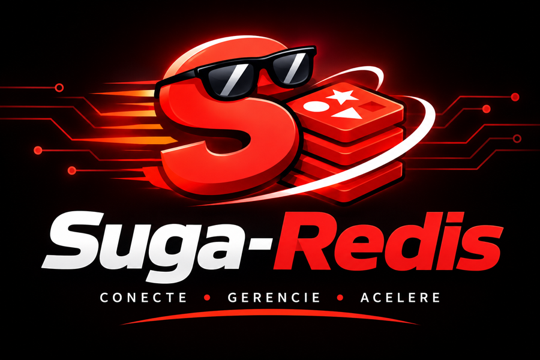
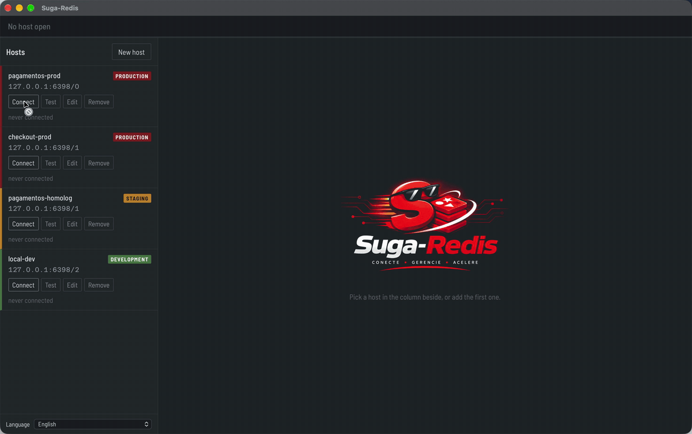
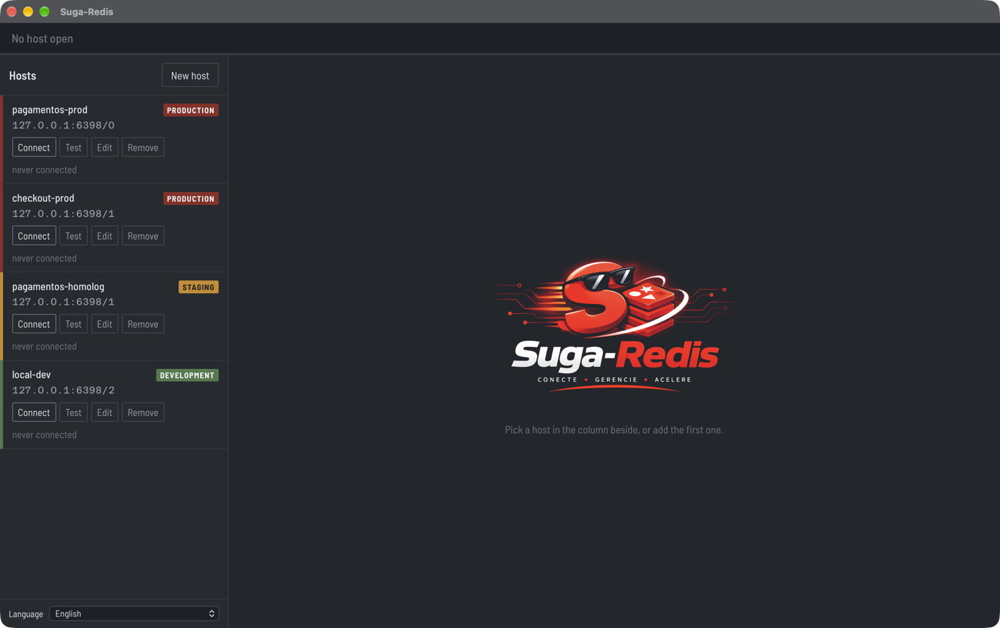
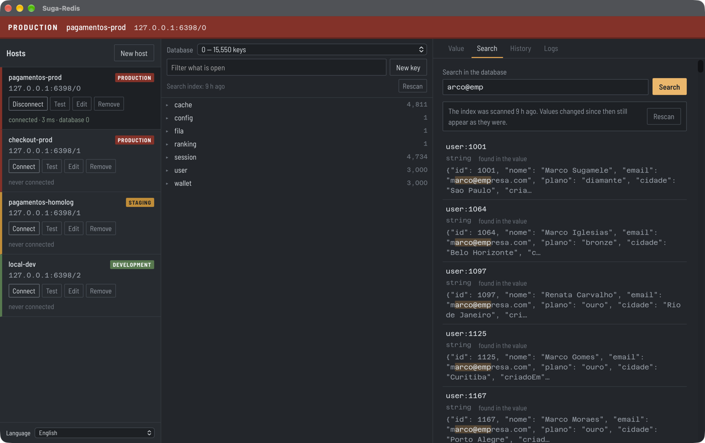
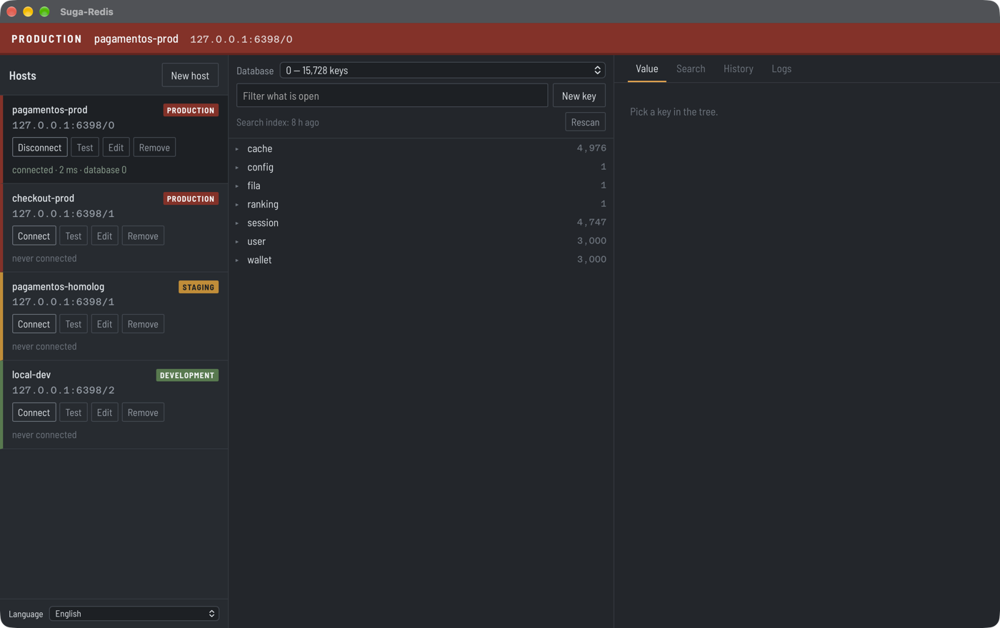
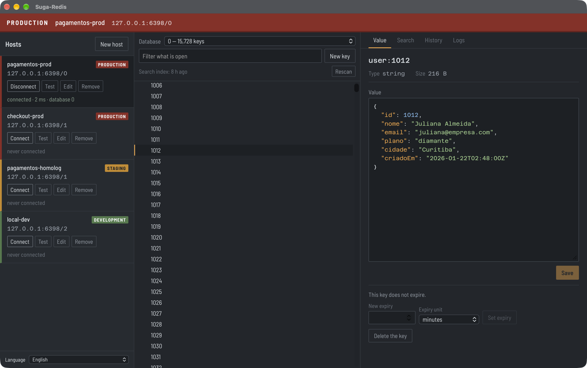
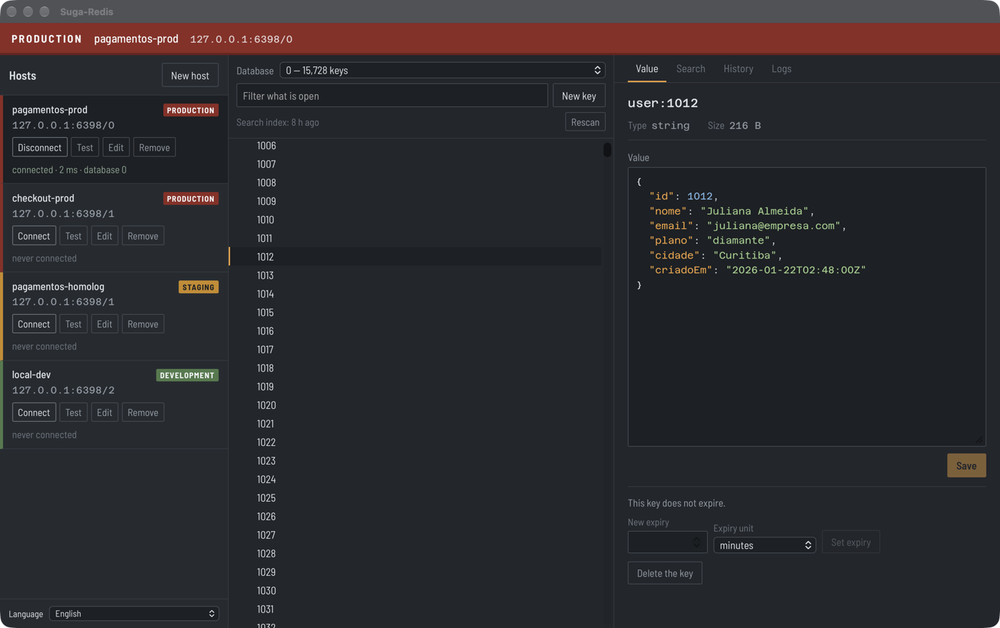
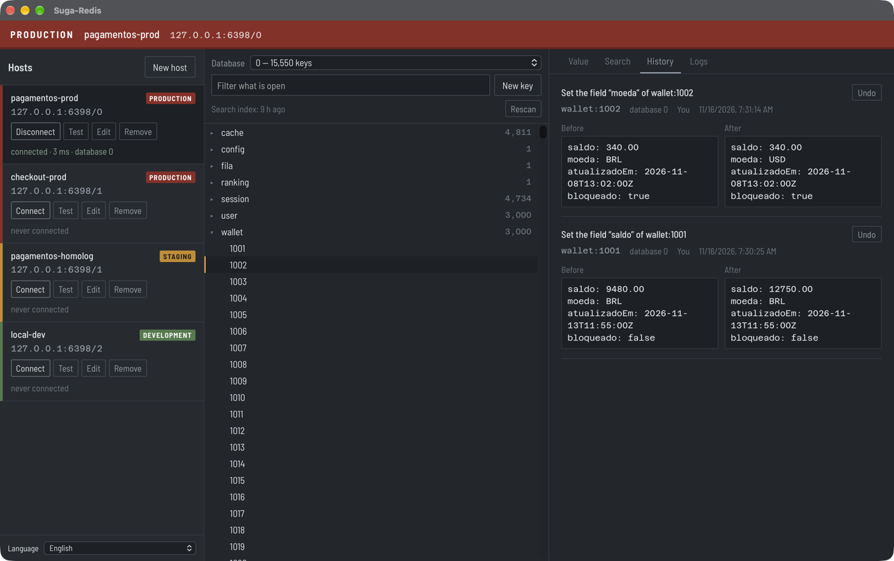
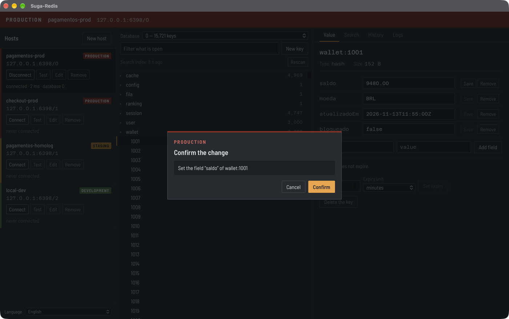
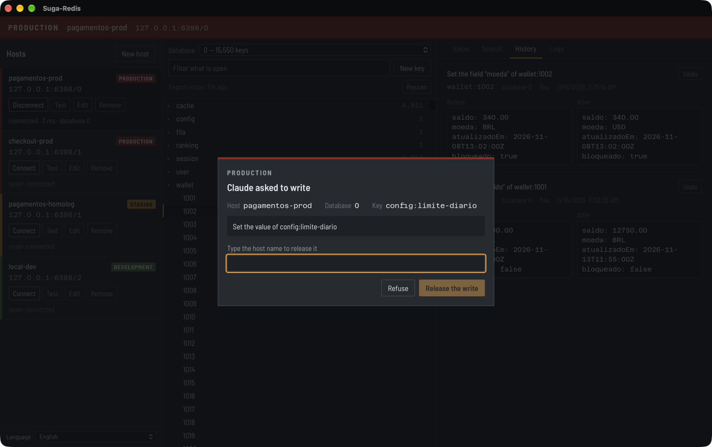

<div align="center">



**连接 · 管理 · 加速**

一个面向生产环境的 Redis 桌面客户端 —— 为那些在按下任何按钮之前，
必须先确认*自己站在哪里*的人而做。

[](https://github.com/suga/suga-redis/releases/latest)
[](https://github.com/suga/suga-redis/actions/workflows/ci.yml)
[](#macos)
[](#linux)
[](#许可证)

[English](README.md) · [Português (BR)](README.pt-BR.md) · [Español](README.es.md) · **简体中文** · [Русский](README.ru.md)

### [⬇️  下载最新版本](https://github.com/suga/suga-redis/releases/latest)

macOS 用 `.dmg` · Linux 用 `.AppImage` 和 `.deb` · 之后自动更新

<br>



</div>

## 问题

你打开一个 Redis 工具，看到五个长得一模一样的标签页。其中一个是生产环境。
是哪一个？

你要找邮箱为 `ana@empresa.com` 的那个客户，但它藏在一个 JSON 里，
那个 JSON 又藏在一个键里，而这样的键有五万个。

你保存了。保存错了键。然后呢？

Suga-Redis 从设计上回答了这三个问题。

## 它做什么

### 🚦 环境会在你出错之前先喊出来

整个窗口会根据打开的主机变色，顶部盖上一个词：
`PRODUCTION`（生产）、`STAGING`（预发布）、`DEVELOPMENT`（开发）。

在整个程序里，全大写**只有一个含义** —— 环境。没有别的标签跟着一起喊，
所以这个印记永远不会被稀释。

在主机列表中，每一行都带着所属环境的颜色标记：一个名字都不用读，
就能看出有多少个生产主机。



### 🌐 三种语言，打开就是你的那一种

界面支持**英语、葡萄牙语和西班牙语** —— 中文还没有，所以系统语言为中文时它会用英语打开。
语言在主机列表底部切换。数字和日期也跟着走 ——
`1,234,567` 和 `1.234.567` 是同一个数，分隔符错了就得重数一遍。

环境印记也一起翻译：一扇朝着看英文的人大喊 `PRODUÇÃO` 的窗口，
喊的恰恰是对方读不懂的那句警告。

### 🔎 能钻进值里面的搜索

搜 `arco@emp`，它会找到 `marco@empresa.com` —— 无论那段文字在 hash 字段里、
list 元素里、sorted set 成员里，还是以字符串形式存放的 JSON 里。

真正的子串匹配，出现在任何位置都算，不限于完整单词。

**实测：5,000 个已索引的键，3 毫秒。**

键名是当场从服务器读取的，所以哪怕是刚刚打开的库，按名称搜索也能直接用，
完全不需要预先扫描。



### 🌳 扛得住真实数据库的键树

键按前缀分组呈现（`wallet:`、`cache:`、`session:`），每个分支都带计数。
列表只绘制屏幕内的内容 —— 几万个键也不会把窗口卡死。

读取过程是刻意精简的：读 5 万个键只需 **11 次往返**，而不是三百五十次。
对于部署在另一个区域的托管 Redis，这就是 1.5 秒与 45 秒的差别。



### ✏️ 按类型区分的编辑器，JSON 带高亮与校验

每种类型都有自己的界面：`string` 用文本框，`hash` 用字段/值表格，
`list` 带下标，`zset` 带成员与分数。

JSON 值打开时就是**带高亮、已缩进**的，可以直接读。



编辑时，校验器会指出错误所在的**行和列** —— 但不会阻止你保存：
Redis 的字符串本来就不必是 JSON，这个决定权在你手里。



二进制值拒绝以文本方式编辑：从输入框回来的东西已经不是原来那些字节了。

### ⏱️ 过期时间随手可改

以倒计时查看还剩多久，用秒、分钟、小时或天设置新的过期时间，
也可以干脆把过期时间去掉。

### ↩️ 真正能撤销

每一次写入都会在**动手之前**先保存旧值。历史记录会显示改了什么、
谁改的、什么时候改的，前后并排对照 —— 还有一个撤销按钮。



### 🔒 生产环境必须确认

在生产主机上保存或删除，会弹出一个写明本次改动确切内容的对话框。
点一下即可，永远不需要照抄一句话。

这道锁住在后端，不在界面上：按钮可能忘记询问，而这个函数绕不过去。



### 🤖 Claude 能读你的库 —— 写入则要先请你放行

同一个可执行文件也是一个 MCP 服务器。接入 Claude Code 之后，
它能直接从你的 Redis 回答诸如*"有多少个 session 键，它们什么时候过期？"*这样的问题。

读取在程序没打开时也能用。**写入不行。** 当 Claude 请求写入时，
窗口会跳到前台，你输入主机名才能放行。程序没开就没有 socket，
写入也就不会发生。



这在**任何环境**都成立，开发环境也不例外：生产确认问的是改动*落在哪里*，
这道锁问的是*谁*提出的。

---

## 安装

> **[⬇️  在这里下载](https://github.com/suga/suga-redis/releases/latest)** —— 然后回到你所用平台的步骤。

### macOS

```bash
# 1. 打开 .dmg，把程序拖进"应用程序"
# 2. 只需执行这一次：
xattr -dr com.apple.quarantine /Applications/Suga-Redis.app
```

好了。从此正常打开 —— 包括之后的更新。

<details>
<summary><b>为什么需要这条命令？</b>（或者说：苹果要每年 99 美元才肯信任我）</summary>

<br>

要让 macOS 打开一个程序时不抱怨，开发者需要一个 **Developer ID** ——
苹果的签名，**每年 99 美元**。这笔钱目前还是咖啡钱。

不付钱，系统就无从知道这个程序来自谁。它并不是在说这个程序危险，
它只是很诚实地说*"我完全不知道这是谁做的"*。这很公道。

上面那条命令，去掉的是浏览器（或 Slack）给所有来自互联网的文件盖上的隔离标记。
实际上你是在对 Gatekeeper 说：**我知道它从哪来，放行吧**。老规矩依然成立 ——
只对你了解来源的文件这么做。这个你了解：全部代码就在这个页面上，
`.dmg` 来自一次公开构建，你可以[逐行阅读](.github/workflows/release.yml)。

**不想用终端？** 官方路径也能到同一个地方：打开程序，让警告出现，
然后去**系统设置 → 隐私与安全性**。往下拉能看到 Suga-Redis 和一个
**仍要打开**按钮。（这一行只在你*尝试打开之后*才出现，大约一小时后消失。
找不到的话，再打开一次，然后赶紧回去看。）

这个程序**确实**签了名 —— 用的是 *ad-hoc* 模式，它保证安装包完整送达、
途中没有被篡改。缺的是付费的那一部分：说明签名者*姓名*的那部分。

</details>

### Linux

**AppImage** —— 推荐，这是能自动更新的格式：

```bash
chmod +x Suga-Redis_*.AppImage
./Suga-Redis_*.AppImage
```

**`.deb`** —— 适用于 Debian、Ubuntu 及其衍生版：

```bash
sudo dpkg -i suga-redis_*.deb
```

这里没有权限惊吓：Linux 就是信任你自己决定机器上跑什么。目前只有 x86_64。

> `.deb` 会提示有新版本，但替换要手动。AppImage 自己就办了。

### 更新

第一次安装之后，你不需要再盯着任何发布公告。

程序启动时会向 GitHub 询问是否有更新版本。如果有，屏幕角落会出现一个
不打扰人的提示，写明改了什么：

- **更新** —— 自动下载、安装并重新打开程序
- **暂不** —— 消失，直到你下次打开

没有你的指令，什么都不会被安装。下载到的包在替换任何东西之前，
都会对照项目的签名密钥校验：对不上的一律拒绝。如果中途断网，
你手上已有的版本依然完好。

### 自己编译

见 [`redis-desk/docs/build.md`](redis-desk/docs/build.md)。三条命令。

---

## 上手

1. 打开程序，点**新建主机**。
2. 填写名称、地址和端口。**认真选择环境** —— 它决定窗口的颜色，
   也决定写入时是否要求确认。
3. 点**连接**。

密码会存进系统钥匙串，绝不会写进文件。

要在值里面搜索，先点一次**重新扫描**：
本地搜索索引就是这样建起来的。按键名搜索不需要它就能用。

### 接入 Claude Code

```bash
claude mcp add suga-redis -- /Applications/Suga-Redis.app/Contents/MacOS/suga-redis --mcp
```

细节与排错见 [`redis-desk/docs/mcp-setup.md`](redis-desk/docs/mcp-setup.md)。

---

## 数据存放在哪里

| 什么 | 在哪里 |
| :- | :- |
| 主机清单 | `<数据>/hosts.json` |
| 历史记录与搜索索引 | `<数据>/suga-redis.sqlite` |
| 放行用的 socket | `<数据>/suga-redis.sock`（权限 0600） |
| **密码** | **系统钥匙串，绝不写进文件** |

`<数据>` 在 macOS 上是 `~/Library/Application Support/com.sugamele.sugaredis`，
在 Linux 上是 `~/.local/share/com.sugamele.sugaredis`。
环境变量 `SUGA_REDIS_DATA_DIR` 可以整体改到别处，
方便并排装第二份。

搜索索引以**明文**保存值，不加密：它只是 Redis 里已有内容的本地副本，
加密它只是把问题换个地方放。能访问你用户账户的人就能访问它。

---

## 它刻意不做的事

- **绝不执行 `KEYS`、`FLUSHALL` 或 `FLUSHDB`。** 扫描只走 `SCAN` 一族，
  不阻塞服务器。
- **不编辑 `set`、`stream` 和 RedisJSON。** 它们以只读方式打开：
  要编辑它们，需要本产品无法原子完成的操作。
- **不调整 list 元素顺序。** 位置交换没有原子操作，拆成两次写入的话，
  第二次失败就会把列表留在错误状态。宁可没有，也好过悄悄弄坏。
- **不对任何值做脱敏。** 界面上不做，给 Claude 看时也不做。
  这是作者记录在案的决定。

---

## 命令行

```
suga-redis              打开窗口
suga-redis --mcp        以 stdio 方式运行 MCP 服务器
suga-redis --version    显示版本
suga-redis --help       显示帮助
```

## 参与贡献

发现了 bug，或者它做了你没料到的事？[提一个
issue](https://github.com/suga/suga-redis/issues) —— 尤其是牵涉到生产库的时候。
那正是这里最在乎的情况。

如果你要动代码：

```bash
git clone https://github.com/suga/suga-redis.git
cd suga-redis/redis-desk
npm install
npm run tauri dev
```

[`redis-desk/docs/CONTEXTO.md`](redis-desk/docs/CONTEXTO.md) 是最省时间的一份阅读：
当前状态、架构、不可破坏的约定，以及那些已经把这个项目弄坏过一次的陷阱。
它和代码注释一样是用葡萄牙语写的。
[`redis-desk/docs/build.md`](redis-desk/docs/build.md) 讲测试、打包和新版本怎么发。

提 PR 之前，CI 会跑这些 —— 所以值得先在本地跑一遍：

```bash
npm test && npm run check          # 界面
cd src-tauri && cargo test         # 内核（需要测试用 Redis：./scripts/test-redis.sh up）
```

## 许可证

MIT。随意使用、复制、修改、分发。

这个项目唯一给不了你的，是苹果那份付费签名 —— 不过命令你已经知道了。

---

<sub>译自 [`README.md`](README.md)。若两者出现分歧，以英文版为准。</sub>
